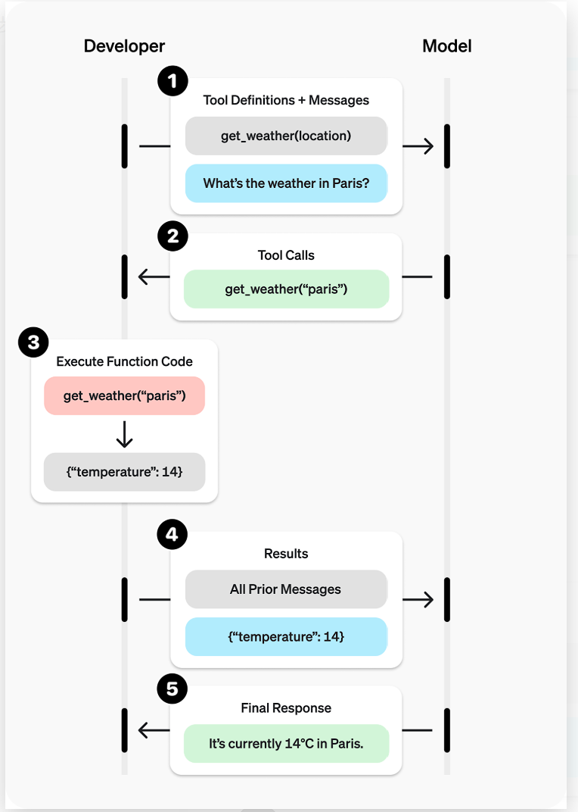

# 什么是FunctionCall
就是函数式调用，它是一种可以将大模型与外部联系的一种方式，新版也成为tool calling
# 调用流程

- 向模型发送包含其可调用工具的请求
- 从模型接收一个要不要做工具调用的结果（包括具体的工具和参数）
- 在应用端执行代码，使用工具调用的输入
- 使用工具输出向模型发起第二次请求，带有工具调用结果
- 接收模型返回的最终响应（或更多工具调用）
# 如何使用
需要有供调用的函数或者是tool。定义一个函数或者tool需要已下参数：
~~~java
{
    "type": "function",
    "name": "get_weather",
    "description": "Retrieves current weather for the given location.",
    "parameters": {
        "type": "object",
        "properties": {
            "location": {
                "type": "string",
                "description": "City and country e.g. Bogotá, Colombia"
            },
            "units": {
                "type": "string",
                "enum": ["celsius", "fahrenheit"],
                "description": "Units the temperature will be returned in."
            }
        },
        "required": ["location", "units"],
        "additionalProperties": false
    },
    "strict": true
}

~~~
>[!TIP]
type:固定值：function 
name:函数的名称 
description:关于何时以及如何使用该函数的详细信息 
parameters:定义函数输入参数的 JSON 模式 
strict:是否对函数调用执行严格模式

当在函数定义中设置strict: true时，将开启结构化输出功能，可以确保模型为Function Calling生成的参数与在函数定义中提供的JSON Schema完全匹配。

# 如何在SpringAi中做FunctionCall
## @Bean + Function<T,R>底层写法
~~~java
@Configuration
public class FunctionCallConfiguration {
    @Bean
    @Description("根据用户输入的时区获取该时区的当前时间")
    public Function<TimeService.Request, TimeService.Response> getTimeFunction(TimeService timeService) {
        return timeService::getTimeByZoneId;
    }
}

~~~
>[!TIP]
TimeService.Request, TimeService.Response，TimeService是自己定义的类

这个`TimeService`：
~~~java
@Service
public class TimeService {
    public Response getTimeByZoneId(Request request) {
        ZoneId zid = ZoneId.of(request.zoneId);
        System.out.println("getTimeByZoneId");
        ZonedDateTime zonedDateTime = ZonedDateTime.now(zid);
        DateTimeFormatter formatter = DateTimeFormatter.ofPattern("yyyy-MM-dd HH:mm:ss z");
        return new Response(zonedDateTime.format(formatter));
    }

    public record Request(
            @JsonProperty(required = true, value = "zoneId") @JsonPropertyDescription("时区，比如 Asia/Shanghai") String zoneId) {
    }

    public record Response(String time) {

    }
}
~~~

## @Tool + @ToolParam
~~~java
public class TimeTools {
    @Tool(description = "Get time by zone id")
    public String getTimeByZoneId(@ToolParam(description = "Time zone id, such as Asia/Shanghai") String zoneId) {
        ZoneId zid = ZoneId.of(zoneId);
        System.out.println("getTimeByZoneId");
        ZonedDateTime zonedDateTime = ZonedDateTime.now(zid);
        DateTimeFormatter formatter = DateTimeFormatter.ofPattern("yyyy-MM-dd HH:mm:ss z");
        return zonedDateTime.format(formatter);
    }
}

~~~
>[!TIP]
`@Tool` 写函数描述，`@ToolParam` 单独给每个参数加描述；

我们发现第一种方案就是将原有的服务转变成了tool，第二种是直接写成了tool原先不存在，第二种更简洁