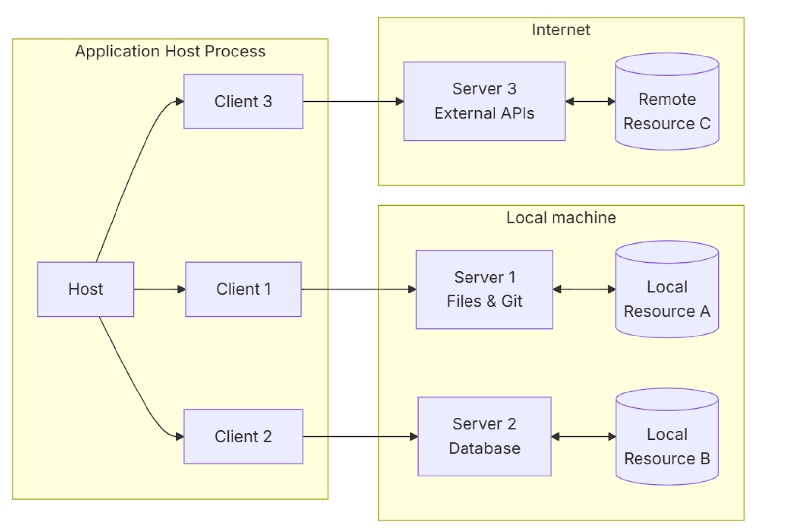
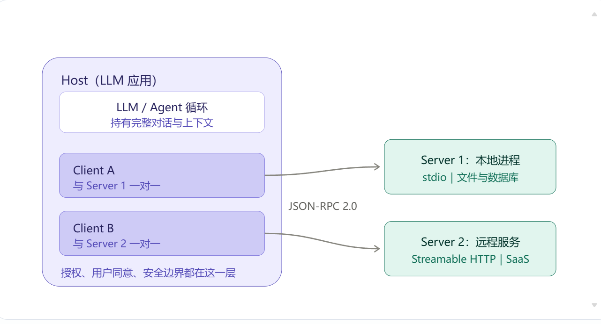
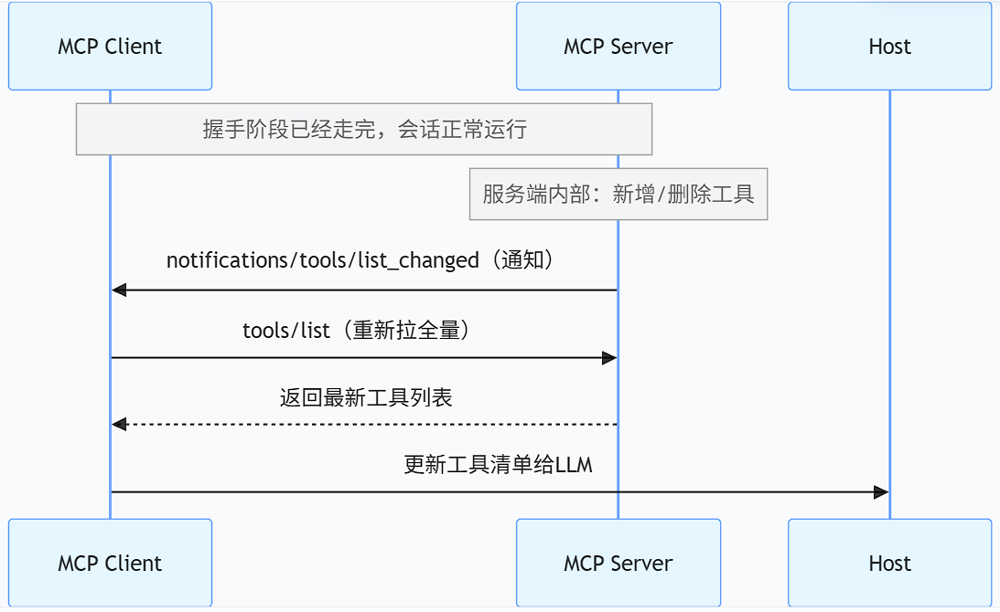
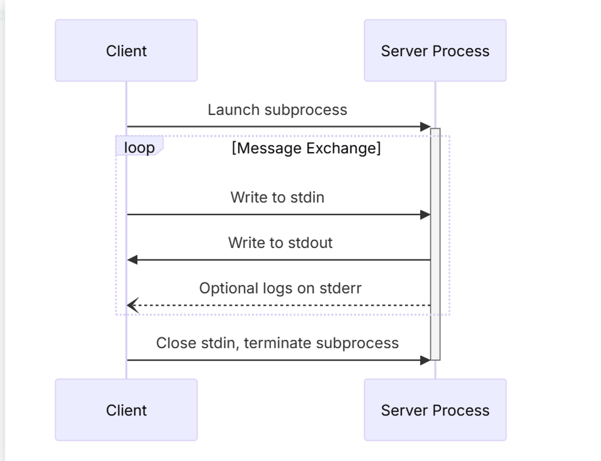
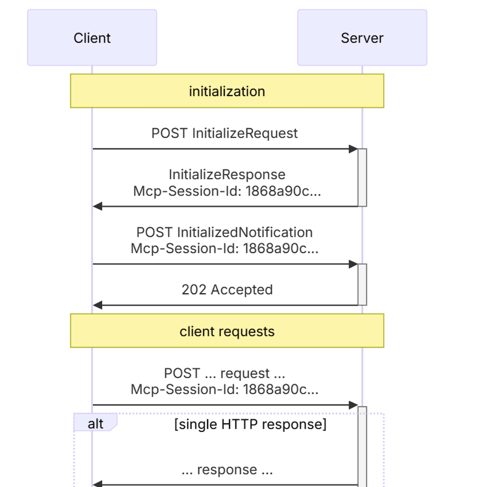

# 一、MCP是什么
MCP，全称是 Model Context Protocol（模型上下文协议）。它是由 Anthropic 开源，旨在解决大模型与外部世界“沟通不畅”的问题。
 
可以看作是AI界的USB接口，它是一种协议，负责Agent通过这个协议调用外部的工具。

## 好处
往常我们想要大模型调用工具，我们需要自己在Agent里或者项目里写入tools代码，然后去调用，但这样就只能现在的项目调用，换一个外部的Agent或者LLM就无法调用了 
但是MCP却将tools抽离出来，我们只需要遵循这样的协议就能调用，而且换别的LLM也可以调用

# 二、MCP构成

我们可以看到其中包含`host`,`MCP Client`,`MCP Server`以及`Remote Resource`,`Local Resource`
## 三层架构
其中`host`,`MCP Client`,`MCP Server`是三层架构

1. **Host（宿主）**：面向用户的 AI 应用，如 Claude Desktop、Cursor、VS Code Copilot、ChatGPT，里面跑大模型，发起连接
2. **MCP Client（客户端）**：宿主内部的连接器，负责和 MCP Server 会话通信、协议转换
3. **MCP Server（服务端）**：能力提供者，向外暴露三类原语，**一次开发，所有兼容 Host 都能调用**
# 三、MCP工作流程
总体上分成四个阶段：
## 3.1 阶段一 （初始化，确认阶段）
1. Host 根据配置，启动 MCP Server 进程（本地 stdio）或者建立远程 HTTP 连接，同时创建一个 MCP Client，**一个 Client 对应一个 Server**
2. Client 发 `initialize` 请求：带上协议版本、客户端信息、自己支持的能力
3. Server 返回：自身支持的协议版本、服务端能力；版本不兼容直接断开
4. Client 发送 `initialized` 通知，握手完成，会话就绪
>[!TIP]
这里有一点像TCP的三次握手

## 3.2 阶段二（能力发现）
Client 主动拉取 Server 暴露的三类原语清单，给到 Host 交给大模型：

- `tools/list`：所有可调用工具、描述、入参 JSON Schema
- `resources/list`：可读取资源（文件、数据库、文档）
- `prompts/list`：预定义提示模板
这样MCP才能知道自己有那些能力
### 原语清单
MCP 里 Server 对外提供的能力就分成这三类，也就是 MCP 的三大核心原语：

1. **Tools（工具）**：可执行动作，比如读文件、执行 shell、查数据库，模型可以主动调用它去做事情（对应 `tools/list`）
2. **Resources（资源）**：只读数据源，比如本地文件、日志、文档，用来给模型补充上下文，**不能执行操作**（对应 `resources/list`）
3. **Prompts（提示模板）**：预写好的提示词 / 固定工作流，比如 “代码评审模板”“需求分析模板”，直接一键启用（对应 `prompts/list`）

## 3.3 阶段三 调用（执行与结果回传）
智能体接收到指令后，立即通过 MCP 协议请求对应的 MCP Server 执行工具操作。MCP Server 完成实际的工具逻辑（如数据库查询），并将**原始执行结果**返回给智能体。

## 3.4 阶段四 结束收尾
返回信息，断开server的连接

>[!TIP]
我们发现无论是MCP还是Funcation Call其实都是智能体去调用的工具，大模型并不会去调用，大模型更像是一个大脑负责**调用以及规划**，不论是 Function Call 还是 MCP，它们在底层与大模型的交互，本质上都要回到同一种能力：向模型发送带**有工具定义（schema）的对话请求**，让模型基于这些标准化描述**返回结构化指令**。

# 四、MCP的原理
MCP中可以分成**传输层**跟**数据层**，并进行规范 
MCP底层是一种**协议**，在传输层有两种方式传输一种是`stdio`本地传输使用的，一种是`Streamable HTTP`,无论这两个方式如何，消息都是遵循`JSON‑RPC 2.0`作为底层消息格式，也就是数据层的格式
## 4.1 MCP 数据层的标准化
也就是我们上面提到的`JSON‑RPC 2.0`，这是一种消息封装的标准规范，在上面我们介绍的MCP工作第一个阶段就是通过是否符合这个协议来判断是否能被调用 
JSON-RPC 就是两个服务之间通过发送 JSON 数据来进行沟通的一种“通用语言”。
- RPC (Remote Procedure Call)：就是指远程过程调用。它的核心思想是：我在 A 服务上调用一个函数（比如 getWeather()），但实际上这个函数是在 B 服务上运行的，B 把结果运行完再传回给 A。
- JSON：所有的数据传输都使用最通用的 JSON 格式，这意味着无论你的智能体是用什么编程语言写的，大家都能看懂对方发来的信息，而且这样的请求是非常简洁高效的。
- 无状态 (Stateless)：每一次请求都是独立的，就像寄信一样，寄出去一封，收回来一封，协议本身不记忆之前的状态。
 

### 1.第一阶段请求
比如我们以MCP第一阶段发送的请求为例：

~~~JSON
{
  "jsonrpc": "2.0", //版本号固定，说明是 JSON-RPC2.0
  "id": 1, // ID：请求的编号号，用于匹配回信
  "method": "initialize", //MCP 规定的方法名
  "params": { //参数
    "protocolVersion": "0.1.0",
    "capabilities": {
      "tools": {}
    },
    "clientInfo": {
      "name": "my-mcp-client",
      "version": "1.0.0"
    }
  }
}

~~~

返回：
~~~JSON
{
  "jsonrpc": "2.0",
  "id": 1,
  "result": {
    "protocolVersion": "0.1.0",
    "capabilities": {
      "tools": {
        "listChanged": true
      }
    },
    "serverInfo": {
      "name": "file-server",
      "version": "0.0.1"
    }
  }
}

~~~
在client收到server返回的上述消息后就会发送以下信息，进行后续业务进行：
~~~JSON
{
  "jsonrpc": "2.0",
  "method": "notifications/initialized" //表明成功初始化
}
~~~
### 2.第二阶段请求
~~~JSON
{
  "jsonrpc": "2.0",
  "method": "tools/list", //获取可以使用的工具
  "params": {},
  "id": 100
}
~~~
返回结果：
~~~JSON
{
  "jsonrpc": "2.0",
  "id": 2,
  "result": {
    "tools": [
      {
        "name": "read_file",
        "description": "读取本地文件内容",
        "inputSchema": {
          "type": "object",
          "properties": {
            "path": {
              "type": "string",
              "description": "文件路径"
            }
          },
          "required": ["path"]
        }
      }
    ]
  }
}

~~~

### 3.阶段三
工具调用请求，这里调用的是读取文件的工具：
~~~JSON
{
  "jsonrpc": "2.0",
  "id": 3,
  "method": "tools/call", //表明是调用工具的请求
  "params": {
    "name": "read_file",
    "arguments": {
      "path": "/test/demo.txt"
    }
  }
}
~~~
Server返回结果：
~~~JSON
{
  "jsonrpc": "2.0",
  "id": 3, //与上面的id进行匹配
  "result": {
    "content": [
      {
        "type": "text",
        "text": "这是demo.txt里面的文本内容"
      }
    ]
  }
}

~~~
### 工具发生改变
在工具list建立完毕之后，如果我们修改了MCP就会由server发送消息,**这里不带id**：
~~~JSON
{
  "jsonrpc": "2.0",
  "method": "notifications/tools/list_changed"
}

~~~
client不需要返回，收到信息后就会重新获取tools的list列表，这样就能保证始终一致性

## 4.2 传输层的标准化
其实有三种传输方式除了`stdio`,`Streamable HTTp`,还有`SSE`但是这个已经逐渐被淘汰了，因为它需要两个通道分别去发送以及接受消息，不支持重连
### stdio本地传输
也就是本地直连，这是 MCP 最原始、最高效的传输方式，也是 Claude、Cursor 等本地客户端智能体的首选集成方式。 

host 把 MCP Server 启动成一个**子进程**，比如Claude desktop中：
~~~JSON
{
  "mcpServers": {
    "fileserver": {
      "command": "python", //启动 server 的可执行文件，args 是参数
      "args": ["/path/file_server.py"]
    }
  }
}

~~~
- `stdin`：子进程的标准输入 → Host 往这里**写 JSON-RPC 消息**（Host → Server,下行通道）
- `stdout`：子进程的标准输出 → 子进程把 **JSON-RPC 消息打印到这里**（Server → Host,上行通道）
- 错误通道：日志信息通常写入 stderr，这样不会干扰正常的 JSON 数据流。host需要忽略此消息
>[!TIP]
这里需要注意的是，client也是这样的，在初始化,堵塞式等待`initialize`成功后，后续的工具调用等等client就会借助stdio与server进行消息传输

client-server交互：

#### 特性
- host的是否关闭决定了server的生命周期
- 通过这样的父子进程方式，不需要TCP/HTTP协议，开销小，效率高

### Streamable HTTP
Streamable HTTP 的出现，就是为了解决 SSE 模式中**读写分离带来的架构复杂度**和传统 HTTP的一次性交互无法满足 MCP **双向异步通知**、以及无法**断点重连** 等问题。

技术原理：Streamable HTTP 的核心是统一和流式化。它将所有交互都汇集到一个标准的 HTTP POST 请求中，并利用 HTTP 的流式能力来承载 MCP 的 JSON-RPC 协议。
- 单一连接：Client 只需要连接一个**统一的端点**（/mcp），无需维护两个分离的通道。
- 请求发送：Client 将 JSON-RPC 报文（如 tools/call）放在 POST 请求的 Body 中发送给 Server。
- 流式响应：Server 接收请求后，并不会立即关闭连接。它会利用 HTTP 协议的分块传输编码 (Chunked Encoding) ，将响应（包括结果、日志、通知）分批次、实时地写入 POST 响应的 Body 中。 
核心优势：
- 简化架构：只需要一个 HTTP 端点，不再读写分离即可实现双向异步通信。
- 灵活性强：可以根据场景选择是否使用流式 SSE 响应，不必每次都保持长连接，支持无状态模式。
- 资源效率更高：不用一直维持 SSE 长连接时，节省资源；需要流时也能按需开启。
- 更可靠的恢复机制：支持断点重连，可恢复会话（通过 Session ID + Last‑Event-ID），通信更稳定。
- 基础设施更友好：与标准 HTTP 基础设施（API 网关、负载均衡、云服务）兼容性更好。
- 向后兼容：既可以支持新的 Streamable HTTP，也可以保留旧 SSE 通道，方便平滑升级。

#### 整体时序流程
1. Client 发起 POST /mcp，body 是 `initialize` 请求（带 id）
~~~JSON
POST /mcp HTTP/1.1
Host: mcp.example.com
Accept: application/json, text/event-stream
MCP-Protocol-Version: 0.1.0
Mcp-Method: initialize
Content-Type: application/json

{
  "jsonrpc": "2.0",
  "id": 1,
  "method": "initialize",
  "params": {
    "protocolVersion": "0.1.0",
    "capabilities": {"tools": {}},
    "clientInfo": {"name":"my-client","version":"1.0.0"}
  }
}

~~~
2. Server 校验版本、能力，响应：
   - 简单：直接 JSON 返回 initialize 结果
~~~JSON
HTTP/1.1 200 OK
Content-Type: application/json //一次性输出

{
  "jsonrpc": "2.0",
  "id": 1,
  "result": {
    "protocolVersion": "0.1.0",
    "capabilities": {"tools":{"listChanged":true}},
    "serverInfo": {"name":"remote-file-server","version":"0.1.0"}
  }
}

~~~

   - 或者开启 SSE 流，在流里面下发结果

~~~JSON
HTTP/1.1 200 OK
Content-Type: text/event-stream //SSE 流式响应
Cache-Control: no-cache
Connection: keep-alive

data: {"jsonrpc":"2.0","method":"notifications/progress","params":{"progress":0.5}}

data: {"jsonrpc":"2.0","id":1,"result":{"content":[{"type":"text","text":"文件内容"}]}}

~~~

3. Client 收到 initialize 成功响应后，POST 发送 `notifications/initialized`（通知，无 id）
~~~JSON
POST /mcp HTTP/1.1
Accept: application/json, text/event-stream
Mcp-Method: initialized
Content-Type: application/json

{
  "jsonrpc": "2.0",
  "method": "notifications/initialized"
}
~~~
4. Server 返回 202 Accepted，没有响应体
5. 握手完成，接下来可以：`tools/list`、`call_tool`
6. 如果需要持续监听工具 / 资源变更：发送 `subscriptions/listen` 请求，服务端维持 SSE 长流，在这个流里推送 `tools/list_changed` 这类变更通知
