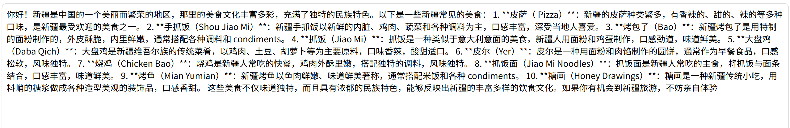

# 一、认识LangChain
它是一个开发框架，用于连接不同的AI模型，作用跟`SpringAI`一样，这个框架是专门给py使用的，简化了LLM的开发
# 二、认识LangChain4j
这是借助`LangChain`的原理，为java语言专门设计的一套开发框架，跟springAI功能是一样的，但是在使用方法上不同
## 2.1 特征
它为我们提供了**低层次API**和**高层次API**
- 低层次：提供了如下Basics（**大模型、提示词模版、模型记忆**等）和RAG（**向量模型、向量数据库、文本载入分割工具**）两类低层次接口，开发者从而能够灵活的实现这些接口并根据自己的需求进行组合，定制化自己的大模型应用。
- 高层次：就是包装好了底层的原理，使用者可以直接调用这些实现好的接口和类，而不需要自己手动根据低层次API修改了
  
---
Chains跟AI Service就是高层次API中的,前者我们可以借助它配置低层次API的顺序，后者类似`chatclient`我们只需要定义一个该类的接口，就能自定义配置`memory`,`tools`等

---
## 2.2 接入LangChain4j
### 2.2.1 依赖引入
~~~xml
<dependency>
    <groupId>dev.langchain4j</groupId>
    <artifactId>langchain4j</artifactId>
    <version>1.8.0</version>
</dependency>

<dependency>
    <groupId>dev.langchain4j</groupId>
    <artifactId>langchain4j-open-ai-spring-boot-starter</artifactId>
    <version>1.8.0-beta15</version>
</dependency>
~~~
>[!TIP]
一个是核心依赖包，第二个是一些配置好的bean
### 2.2.2 配置文件配置
#### 1.本地Ollama配置
##### 依赖引入
~~~xml

    <properties>
        <java.version>21</java.version>
        <langchain4j.version>1.18.0</langchain4j.version>
    </properties>
<!-- langchain4j核心依赖引入 -->
   <dependency>
            <groupId>dev.langchain4j</groupId>
            <artifactId>langchain4j</artifactId>
            <version>${langchain4j.version}</version>
        </dependency>
<!-- openai的langchain4j的依赖引入 -->
        <dependency>
            <groupId>dev.langchain4j</groupId>
            <artifactId>langchain4j-open-ai-spring-boot-starter</artifactId>
            <version>${langchain4j.version}-beta28</version>
        </dependency>

<!-- ollama的langchain4j的依赖引入 -->
        <dependency>
            <groupId>dev.langchain4j</groupId>
            <artifactId>langchain4j-ollama-spring-boot-starter</artifactId>
            <version>${langchain4j.version}-beta28</version>
        </dependency>

~~~
>[!TIP]
这里都采取同样的版本号进行依赖引入，注意到我们想要使用ollama就需要ollama的langchain4j的依赖引入
##### 项目文件配置
~~~yml
spring:
  application:
    name: demo
langchain4j:
  ollama:
    chat-model:
      base-url: http://localhost:11434
      model-name: deepseek-r1:7b
      temperature: 0.7

~~~
##### 启动ollama
前面我们讲过如何进行ollama本地部署一个AI，这里不再赘述。 
直接在docker中启动ollama容器即可
##### 测试代码
~~~java
@RestController
@RequestMapping("/langchain/low/")
public class LangChainLowLevelController {

    @Autowired
    OllamaChatModel ollamaChatModel;

    @GetMapping("/hello")
    public String hello(){
        return ollamaChatModel.chat("Hello, how are you?");
    }
}

~~~
启动调用此接口即可：

#### 2.openAI配置
依赖引入就是上面的openAI依赖 
配置文件：这里是阿里百炼平台
~~~yml
langchain4j:
  open-ai:
    chat-model:
      api-key: @dashscope.api.key@
      model-name: qwen-max-latest
      base-url: https://dashscope.aliyuncs.com/compatible-mode/v1
      log-requests: true
      log-responses: true
~~~
~~~java
@RestController
@RequestMapping("/langchain/low")
public class LangChainLowLevelController {

    @Autowired
    OpenAiChatModel chatModel;

    @RequestMapping("/hello")
    public String hello() {
        return chatModel.chat("你好,你是谁？");
    }
}
~~~
注意这里注入的模型与上面ollama不同
## 2.3 流式输出
与springAI不同的是，langchain4j需要单独配置`StreamingChatModel`的依赖 
本地ollama：
~~~yml
langchain4j:
  ollama:
    # 同步模型（之前用的）
    chat-model:
      base-url: http://localhost:11434
      model-name: llama3.1
      temperature: 0.7
      timeout: 60s
    # ✅ 流式模型【核心】
    streaming-chat-model:
      base-url: http://localhost:11434
      model-name: llama3.1
      temperature: 0.7
      timeout: 60s
~~~
openAI：
~~~yml
langchain4j:
  open-ai:
    chat-model:
      api-key: @dashscope.api.key@
      model-name: qwen-max-latest
      base-url: https://dashscope.aliyuncs.com/compatible-mode/v1
      log-requests: true
      log-responses: true
    streaming-chat-model:
      api-key: @dashscope.api.key@
      model-name: qwen-max-latest
      base-url: https://dashscope.aliyuncs.com/compatible-mode/v1
      log-requests: true
      log-responses: true
~~~
然后再根据不同的平台注入不同的model，ollama注入`OllamaStreamingChatModel`,openAI注入`OpenAiStreamingChatModel` 
接口编写：
~~~java
 @GetMapping("/hello-streaming")
    public void streamTest(HttpServletResponse response) {
        response.setCharacterEncoding("UTF-8");
        ollamaStreamingChatModel.chat("你好,给我推荐一些新疆美食？", new StreamingChatResponseHandler() {
            @Override
            public void onPartialResponse(String partialResponse) {
                System.out.println(partialResponse);
            }

            @Override
            public void onCompleteResponse(ChatResponse completeResponse) {
                System.out.println("===输出结束===");
            }

            @Override
            public void onError(Throwable error) {
                System.out.println(error);
            }
        });
    }
~~~
>[!TIP]
注意这里与springAI不同的地方在于，这里chat方法还有一个参数重写`StreamingChatResponseHandler`这里面有三个方法，分别是接收到流式返回，完全收到返回，出现错误的三种情况

由于是这个接口是void，那么前端页面就啥也不显示，只有在打印台上能看到

如果想要返回前端以流式的形式：这里就要用`Flux<string>`，这个依赖在reactor中需要再引入这个依赖
~~~xml
    <dependency>
            <groupId>dev.langchain4j</groupId>
            <artifactId>langchain4j-reactor</artifactId>
            <version>1.18.0-beta28</version>
        </dependency>
~~~
接口：
~~~java
@GetMapping(value = "/helloStreaming", produces = MediaType.TEXT_EVENT_STREAM_VALUE)//告诉浏览器是长流式输出，会包装成data:xxx\n\n
    public Flux<String> streamTest2(HttpServletResponse response) {
        response.setCharacterEncoding("UTF-8");//防止乱码
        return Flux.create(sink -> {
            ollamaStreamingChatModel.chat("你好,给我推荐一些新疆美食？", new StreamingChatResponseHandler() {
                @Override
                public void onPartialResponse(String partialResponse) {
                    sink.next(partialResponse);//把生成的这一段文字丢进 Flux 流，推给下游
                }
                @Override
                public void onCompleteResponse(ChatResponse completeResponse) {
                    sink.complete();
                }
                @Override
                public void onError(Throwable error) {
                    sink.error(error);
                }
            });
        });
    }
~~~

我们如果不加`produces = MediaType.TEXT_EVENT_STREAM_VALUE`就不会遵循SSE协议，就会流式正常输出

### 扩展，常见的流式输出方案
1. **SSE**：单向，服务端推消息；底层是普通 HTTP；浏览器自带 `EventSource`；自带断线自动重连；适合 AI 流式输出、通知、日志推送。
2. **WebSocket**：双向，浏览器和服务器互相发消息；升级 HTTP 协议；**不会自动重连**；适合聊天实时互动、游戏、协同编辑。
3. **普通 fetch+ReadableStream（也就是删掉 produces 的方案）**：一次性 HTTP 读流，**没有自动重连**，流读完 / 断开就结束，没有专门消息格式。

如果换成openAI同理只需要替换model即可

# 三、低层次API使用
## 3.1 `chatmodel`
类似于Spring AI中的ChatModel一样。 
常见的方法:
~~~java
ChatResponse chat(ChatRequest chatRequest) 
String chat(String userMessage)
ChatResponse chat(ChatMessage... messages)
ChatResponse chat(List<ChatMessage> messages)
ChatResponse doChat(ChatRequest chatRequest)
~~~
>[!TIP]
除了这个还有`LanguageModel`,`ImageModel`等等，默认的`chatmodel`是OpenAIChatModel
## 3.2 `ChatMessage`
其实就是Spring AI中的Message 
分类：
- UserMessage ：这是来自用户的消息。用户可以是你的应用程序的最终用户（人类）或应用程序本身。
- AiMessage : 这是一个由 AI 生成的消息，作为对已发送消息的回应。
- ToolExecutionResultMessage : 这是 ToolExecutionRequest 的结果。
- SystemMessage : 这是一条来自系统的消息。
- CustomMessage : 这是一条自定义消息，可以包含任意属性。
## `ChatRequest`
在模型交互的时候可以设置一些参数比如`temperature`,`message`等等
## 3.3 对话记忆
### 方案一构造List<message>
~~~java
 List<ChatMessage> messages = new ArrayList<>();

    //第一轮对话
    messages.add(systemMessage("你是一个AI助手"));
    messages.add(userMessage("你是一个美食家，叫小明"));
    AiMessage answer = chatModel.chat(messages).aiMessage();
    System.out.println(answer);
    System.out.println("======");

    messages.add(answer);

    //第二轮对话
    messages.add(userMessage("小明是干什么的?"));
    AiMessage answer1 = chatModel.chat(messages).aiMessage();
    System.out.println(answer1);
    System.out.println("======");
~~~
### 方案二`ChatMemory`
~~~java
ChatMemory chatMemory = MessageWindowChatMemory.withMaxMessages(10);

    //第一轮对话
    chatMemory.add(systemMessage("你是一个AI助手"));
    chatMemory.add(userMessage("我是一个美食家，叫小明"));
    AiMessage answer = chatModel.chat(chatMemory.messages()).aiMessage();
    System.out.println(answer);
    System.out.println("======");

    chatMemory.add(answer);

    //第二轮对话
    chatMemory.add(userMessage("小明是干什么的?"));
    AiMessage answer1 = chatModel.chat(chatMemory.messages()).aiMessage();
    System.out.println(answer1);
    System.out.println("======");

    chatMemory.add(answer1);

~~~

## 3.4 结构化输出
如果使用低层次API实现结构化输出：
~~~java
public String structure() {

    ResponseFormat responseFormat = ResponseFormat.builder()
            .type(JSON) // 类型可以是 TEXT（默认）或 JSON
            .jsonSchema(JsonSchema.builder()
                    .name("Person") // OpenAI 要求为 schema 指定名称
                    .rootElement(JsonObjectSchema.builder() // 见下面的 [1]
                            .addStringProperty("name")
                            .addIntegerProperty("age")
                            .addNumberProperty("height")
                            .addBooleanProperty("married")
                            .required("name", "age", "height", "married") // 见下面的 [2]
                            .build())
                    .build())
            .build();

    ChatRequest chatRequest = ChatRequest.builder()
            .responseFormat(responseFormat)
            .messages(UserMessage.from("""
                John is 42 years old and lives an independent life.
                He stands 1.75 meters tall and carries himself with confidence.
                Currently unmarried, he enjoys the freedom to focus on his personal goals and interests.
                """))
            .build();

    return chatModel.chat(chatRequest).aiMessage().text();
}
~~~
## 3.5 工具调用
~~~java
@RequestMapping("tool")
public String tool() {
    //1、定义工具列表
    List<ToolSpecification> toolSpecifications = ToolSpecifications.toolSpecificationsFrom(TemperatureTools.class);
    //2.构造用户提示词
    UserMessage userMessage = UserMessage.from("2025年11月11日，杭州的气温怎样？");
    List<ChatMessage> chatMessages = new ArrayList<>();
    chatMessages.add(userMessage);
    //3. 创建ChatRequest，并指定工具列表
    ChatRequest request = ChatRequest.builder()
            .messages(userMessage)
            .toolSpecifications(toolSpecifications)
            .toolChoice(ToolChoice.AUTO)
            .build();
    //4. 调用模型
    ChatResponse response = chatModel.chat(request);
    AiMessage aiMessage = response.aiMessage();
    //5.把模型结果添加到chatMessages中
    chatMessages.add(aiMessage);

    //6.执行工具，这里需要手动的去调用工具
    List<ToolExecutionRequest> toolExecutionRequests = response.aiMessage().toolExecutionRequests();
    toolExecutionRequests.forEach(toolExecutionRequest -> {
        ToolExecutor toolExecutor = new DefaultToolExecutor(new TemperatureTools(), toolExecutionRequest);
        System.out.println("execute tool " + toolExecutionRequest.name());
        String result = toolExecutor.execute(toolExecutionRequest, UUID.randomUUID().toString());
        ToolExecutionResultMessage toolExecutionResultMessages = ToolExecutionResultMessage.from(toolExecutionRequest, result);
        //7.把工具执行结果添加到chatMessages中
        chatMessages.add(toolExecutionResultMessages);
    });

   //8.重新构造ChatRequest，并使用之前的对话chatMessages，以及指定toolSpecifications
ChatRequest finalRequest = ChatRequest.builder()
        .messages(chatMessages)
        .toolSpecifications(toolSpecifications)
        .build();

//9. 再次调用模型，返回结果
ChatResponse finalChatResponse = chatModel.chat(finalRequest);
return finalChatResponse.aiMessage().text();
}

~~~
这里的`TemperatureTools`是自定义的tool工具类：
~~~java
public class TemperatureTools {

    @Tool(value = "Get temperature by city and date", name = "getTemperatureByCityAndDate")
    public String getTemperatureByCityAndDate(@P("city for get Temperature") String city, @P("date for get Temperature") String date) {
        System.out.println("getTemperatureByCityAndDate invoke...");
        return "16摄氏度";
    }
}
~~~
>[!NOTE]
通过Tool注解，第一个参数是描述干啥，第二个是工具的名字，通过P注解给参数解释

# 四、高层次API的使用
使用高层次API需要先加入一个依赖
~~~xml
<dependency>
    <groupId>dev.langchain4j</groupId>
    <artifactId>langchain4j-spring-boot-starter</artifactId>
    <version>1.8.0-beta15</version>
</dependency>
~~~
核心就是`@AiService`注解
## 对话功能
我们需要先定义一个接口并标注为`@AiService`
~~~java
@AiService
public interface LangChainAiService {

    String chat(String userMessage);

}
~~~
>[!TIP]
标注这个注解就会将这个方法暴露成bean，这样就可以注入了

然后我们就可以调用了：
~~~java
@Autowired
private LangChainAiService aiService;

@RequestMapping("/chat")
public String chat(HttpServletResponse response) {
    response.setCharacterEncoding("UTF-8");
    return aiService.chat("美国的历史是什么？");
}
~~~
>[!NOTE]
这里底层会调用chat方法，所以就不需要自己再手动写了，而且这里面的方法名称是自定义的

### 流式输出
~~~java
@AiService
public interface LangChainAiService {

    String chat(String userMessage);

    Flux<String> chatStream(String userMessage);
}
~~~
## 提示词模板
注意这里的提示词占位符
~~~java
@AiService
public interface LangChainAiService {

    @SystemMessage("你是一个杠精，擅长怼人")
    @UserMessage("针对用户的内容：{{topic}}，先复述一遍他的问题，然后再回答")
    Flux<String> chatStream(String topic);
}
~~~
在文件中也可以使用：
~~~java
@UserMessage(fromResource = "your-prompt-template.txt")
String chat(String topic);
~~~
## 结构化输出
AIService中：
~~~java
@UserMessage("请帮我推荐1本java相关的书")
@SystemMessage("你是一个专业的图书推荐人员")
Book getBooks();
~~~
调用
~~~java
@RequestMapping("/structure1")
public String structure1(HttpServletResponse response) {
    response.setCharacterEncoding("UTF-8");
    Book books = aiService.getBooks();
    return books.toString();
}
~~~
## 记忆会话
~~~java
@AiService
public interface LangChainMemoryAiService {

    String chatMemory(@MemoryId String memoryId, @UserMessage String userMessage);
}
~~~
>[!NOTE]
这里的`@UserMessage`就是表面这是一个写入UserMessage的参数，相比较与上面的写在方法上的方式，这样更动态，不用写死，`@MemoryId`通过这个标注的参数来区分记忆

到此，我们并不能像之前一样直接注入，还需要提供一个`chatMemoryProvider`：
~~~java
LangChainMemoryAiService langChainMemoryAiService = AiServices.builder(LangChainMemoryAiService.class)
                .chatModel(chatModel)
                .streamingChatModel(streamingChatModel)
                .chatMemoryProvider(memoryId -> MessageWindowChatMemory.withMaxMessages(10))
                .build();
~~~
或者也可以单独配置一个ChatMemoryProvider的Bean
>[!NOTE]
注意的是必须公用一个`langChainMemoryAiServic`才能生效，要不然无法进行记忆区分

## 工具调用
写好工具类：
~~~java
public class TemperatureTools {
    // 描述一定要写清楚，大模型靠这个理解什么时候调用
    @Tool("查询指定城市、指定日期的气温")
    public String getTemperature(
            @P("城市名称") String city,
            @P("日期，格式yyyy-MM-dd") String date
    ) {
        // 你的业务逻辑：查数据库、调用第三方接口
        return "22℃";
    }
}
~~~
- `@Tool`：标记这是工具
- `@P`：参数描述，给模型看，用来填参数 
定义 AiService，绑定工具：
~~~java
// 把工具类绑定进来
@AiService(tools = "TemperatureTools")
public interface ChatService {
    // 普通文本
    String chat(String prompt);

    // 带记忆 + 工具（就是你刚才看的）
    String chatMemory(@MemoryId String memoryId, @UserMessage String userMessage);

    // 流式返回Flux，同样支持工具调用
    Flux<String> streamChat(String prompt);
}

~~~
1. 注解上 `tools = "xxx"`：**这个接口所有方法都能使用这批工具**（最常用）
2. 方法上 `@Tool("TemperatureTools")`：**仅当前这个方法可以使用这批工具**，粒度更细
注入调用即可：这里是全部方法都会使用tool
~~~java
@Autowired
ChatService chatService;

// 调用，框架内部自动处理全部工具循环
String res = chatService.chat("今天杭州气温多少？");

~~~
除了上面的调用方法我们也可以手动调用，这样就不需要配置为Aiservice绑定tool：
~~~java
    LangChainAiService langChainAiService1 = AiServices.builder(LangChainAiService.class)
            .tools(new TemperatureTools())
            .chatModel(chatModel)
            .build();

    return langChainAiService1.chat("今天杭州气温多少？");
~~~
但是这样有问题就是每次调用都会new一个新的对象
# 五、高层次API中`@AiService`的原理
**基于 JDK 动态代理 + 方法拦截**，你只定义空接口，框架运行时生成代理实现类；调用接口方法时，拦截器自动完成消息组装、模型调用、工具循环、记忆读取、结果解析，屏蔽底层 `ChatRequest`、`toolExecutionRequest` 这些繁琐代码。
## 5.1 前置基础
### JDK动态代理：
- JDK动态代理，只能代理接口所以我们发现所有的@AiService标注的全部都是接口，而不是类
- 这是 `AiServices.builder().build()` 的底层，不管注解方式还是手动 builder，最终产出物都是这个代理对象`Proxy.newProxyInstance()` 生成一个**实现该接口的匿名代理类**。

### Spring 的 BeanDefinition 生命周期（注解扫描的载体）：

Spring 启动分两大阶段：

1. **BeanDefinition 解析阶段（还没实例化任何对象）**：只收集 Bean 的元数据（类名、属性、依赖），存放在 `BeanDefinitionRegistry`；
2. **Bean 实例化阶段**：根据 BeanDefinition，反射创建对象、填充属性、初始化。

后置处理器的作用就是**在这两个阶段插钩子**：

- `BeanDefinitionRegistryPostProcessor`：可以新增、删除 BeanDefinition（优先级最高）
- `BeanFactoryPostProcessor`：修改已经存在的 BeanDefinition
- `BeanPostProcessor`：Bean 实例创建完成之后，对实例做包装（AOP 就是这个）

## 5.2 Spring 自动配置层：AiServicesAutoConfig
### 阶段一
`AiServiceScannerProcessor`实现了接口`BeanDefinitionRegistryPostProcessor`负责**发现所有带 @AiService 的接口**
- 1.通过内置 `ClassPathBeanDefinitionScanner`，过滤器：`AnnotationTypeFilter(AiService.class)`
- 2.给扫描到的接口注册一个**占位 BeanDefinition**

### 阶段二
`aiServicesRegisteringBeanFactoryPostProcessor`实现了`BeanFactoryPostProcessor`，负责**替换占位 BeanDefinition，改成 FactoryBean**
1. 遍历容器中所有 BeanDefinition，筛选出刚才 Scanner 注册的、被`@AiService`标记的接口 BeanDefinition
~~~java
  String[] aiServices = beanFactory.getBeanNamesForAnnotation(AiService.class);
~~~
2. 新建 `AiServiceFactoryBean` 的 BeanDefinition，覆盖同一个 beanName
~~~java
// aiService 是beanName（字符串）
// 根据beanName拿到它对应的Class类型，也就是我们被@AiService标记的接口
Class<?> aiServiceClass = beanFactory.getType(aiService);

// 新建一个GenericBeanDefinition（新的BD图纸）
GenericBeanDefinition aiServiceBeanDefinition = new GenericBeanDefinition();
// 图纸上的beanClass设置成 AiServiceFactory.class（工厂类）
aiServiceBeanDefinition.setBeanClass(AiServiceFactory.class);

// 给工厂的构造器传入参数：目标接口Class
aiServiceBeanDefinition.getConstructorArgumentValues()
        .addGenericArgumentValue(aiServiceClass);

// 准备给这个BD设置属性（后面会往里面塞 chatModel、tool列表、memoryProvider 等）
MutablePropertyValues propertyValues = aiServiceBeanDefinition.getPropertyValues();

// 拿到这个接口上的 @AiService 注解，读取注解上的属性：tools、toolChoice等
AiService aiServiceAnnotation = (AiService)aiServiceClass.getAnnotation(AiService.class);

~~~
3. 把全部元数据塞进这个 FactoryBean：
   - 目标接口 Class
   - `@AiService` 注解上的 `tools`、`toolChoice`
   - 容器内需要自动注入的依赖：`ChatLanguageModel` / `StreamingChatLanguageModel`、`ChatMemoryProvider`、`RetrievalAugmentor`
~~~java
 addBeanReference(ChatModel.class, aiServiceAnnotation, aiServiceAnnotation.chatModel(), chatModels, "chatModel", "chatModel", propertyValues);
                addBeanReference(StreamingChatModel.class, aiServiceAnnotation, aiServiceAnnotation.streamingChatModel(), streamingChatModels, "streamingChatModel", "streamingChatModel", propertyValues);
                addBeanReference(ChatMemory.class, aiServiceAnnotation, aiServiceAnnotation.chatMemory(), chatMemories, "chatMemory", "chatMemory", propertyValues);
                addBeanReference(ChatMemoryProvider.class, aiServiceAnnotation, aiServiceAnnotation.chatMemoryProvider(), chatMemoryProviders, "chatMemoryProvider", "chatMemoryProvider", propertyValues);
                addBeanReference(ContentRetriever.class, aiServiceAnnotation, aiServiceAnnotation.contentRetriever(), contentRetrievers, "contentRetriever", "contentRetriever", propertyValues);
                addBeanReference(RetrievalAugmentor.class, aiServiceAnnotation, aiServiceAnnotation.retrievalAugmentor(), retrievalAugmentors, "retrievalAugmentor", "retrievalAugmentor", propertyValues);
                addBeanReference(ModerationModel.class, aiServiceAnnotation, aiServiceAnnotation.moderationModel(), moderationModels, "moderationModel", "moderationModel", propertyValues);
                if (aiServiceAnnotation.wiringMode() == AiServiceWiringMode.EXPLICIT) {
                    propertyValues.add("tools", toManagedList(Arrays.asList(aiServiceAnnotation.tools())));
                } else {
                    if (aiServiceAnnotation.wiringMode() != AiServiceWiringMode.AUTOMATIC) {
                        throw Exceptions.illegalArgument("Unknown wiring mode: " + String.valueOf(aiServiceAnnotation.wiringMode()), new Object[0]);
                    }

                    propertyValues.add("tools", toManagedList(toolBeanNames));
                }
~~~
4. **移除原来的接口 BeanDefinition**
~~~java
  BeanDefinitionRegistry registry = (BeanDefinitionRegistry)beanFactory;
                registry.removeBeanDefinition(aiService);
~~~
5. 注册这个 FactoryBean 到容器
~~~java
 registry.registerBeanDefinition(lowercaseFirstLetter(aiService), aiServiceBeanDefinition);
~~~

>[!NOTE]
此时替换后的类就可以实例化了，也就可以进行动态代理了

### 阶段三（FactoryBean# getObject ()）
也就是我们的`AiServiceFactoryBean`实现`FactoryBean`重写了getObject
~~~java
  public Object getObject() {
        AiServices<Object> builder = AiServices.builder(this.aiServiceClass);
        if (this.chatModel != null) {
            builder = builder.chatModel(this.chatModel);
        }

        if (this.streamingChatModel != null) {
            builder = builder.streamingChatModel(this.streamingChatModel);
        }

        if (this.chatMemory != null) {
            builder.chatMemory(this.chatMemory);
        }

        if (this.chatMemoryProvider != null) {
            builder.chatMemoryProvider(this.chatMemoryProvider);
        }

        if (this.retrievalAugmentor != null) {
            builder = builder.retrievalAugmentor(this.retrievalAugmentor);
        } else if (this.contentRetriever != null) {
            builder = builder.contentRetriever(this.contentRetriever);
        }

        if (this.moderationModel != null) {
            builder = builder.moderationModel(this.moderationModel);
        }

        if (!Utils.isNullOrEmpty(this.tools)) {
            for(Object tool : this.tools) {
                if (AopUtils.isAopProxy(tool)) {
                    builder = builder.tools(this.aopEnhancedTools(tool));
                } else {
                    builder = builder.tools(new Object[]{tool});
                }
            }
        }

        return builder.build();
    }
~~~
这段代码也就等价于：
~~~java
AiServices.builder(YourAiService.class)
    .chatModel(容器拿到的ChatModel)
    .tools(注解里的工具类实例)
    .toolChoice(注解配置)
    .chatMemoryProvider(容器里的memoryProvider)
    .build();

~~~
`AiServices.builder.build()` 内部：**JDK Proxy 生成代理对象**,Spring 把这个**代理对象**对外暴露，也就是你`@Autowired`拿到的 service
~~~java
 Object proxyInstance = Proxy.newProxyInstance(this.context.aiServiceClass.getClassLoader(), new Class[]{this.context.aiServiceClass}, new InvocationHandler() {
            public Object invoke(Object proxy, Method method, Object[] args) throws Throwable {
                if (method.isDefault()) {
                    return InvocationHandler.invokeDefault(proxy, method, args);
                } else if (method.getDeclaringClass() == Object.class) {
                    switch (method.getName()) {
                        case "equals":
                            return proxy == args[0];
                        case "hashCode":
                            return System.identityHashCode(proxy);
                        case "toString":
                            String var10000 = DefaultAiServices.this.context.aiServiceClass.getName();
                            return var10000 + "@" + Integer.toHexString(System.identityHashCode(proxy));
                        default:
                            throw new IllegalStateException("Unexpected Object method: " + String.valueOf(method));
                    }
                } else if (method.getDeclaringClass() == ChatMemoryAccess.class) {
                    return DefaultAiServices.this.handleChatMemoryAccess(method, args);
                } else {
                    AiServiceValidation.validateParameters(DefaultAiServices.this.context.aiServiceClass, method);
                    InvocationParameters invocationParameters = (InvocationParameters)AiServiceParamsUtil.findArgumentOfType(InvocationParameters.class, args, method.getParameters()).orElseGet(InvocationParameters::new);
                    InvocationContext invocationContext = InvocationContext.builder().invocationId(UUID.randomUUID()).interfaceName(DefaultAiServices.this.context.aiServiceClass.getName()).methodName(method.getName()).methodArguments(args != null ? Arrays.asList(args) : List.of()).chatMemoryId(DefaultAiServices.findMemoryId(method, args).orElse("default")).defaultRequestParameters(determineChatRequestParameters(DefaultAiServices.this.context)).modelProvider(determineModelProvider(DefaultAiServices.this.context)).invocationParameters(invocationParameters).managedParameters(LangChain4jManaged.current()).timestampNow().build();

                    try {
                        return this.invoke(method, args, invocationContext);
                    } catch (Exception ex) {
                        DefaultAiServices.this.context.eventListenerRegistrar.fireEvent(AiServiceErrorEvent.builder().invocationContext(invocationContext).error(ex).build());
                        throw ex;
                    }
                }
            }
~~~
在build中创建了代理对象
- 注解方式本质：框架帮你把手写 `AiServices.builder()` 封装到 FactoryBean 里，延迟到实例化阶段执行。
- 手动 builder：你自己在代码里直接调用上面这一段，不走 Spring 后置处理器扫描。

# 六、持久化记忆
有一个内置的`ChatMemoryStore`接口
~~~java
public interface ChatMemoryStore {
    List<ChatMessage> getMessages(Object var1);

    void updateMessages(Object var1, List<ChatMessage> var2);

    void deleteMessages(Object var1);
}
~~~
>[!TIP]
框架自带序列化工具，**不用自己手写 Jackson 适配多态消息**：

- `ChatMessageSerializer.messagesToJson(List<ChatMessage>)`
- `ChatMessageDeserializer.messagesFromJson(String)`
我们就可以实现此方法来做到外接数据库等等操作实现持久化记忆,我们拿redis举例：
~~~java
@Component
public class RedisChatMemoryStore implements ChatMemoryStore {

    @Autowired
    private StringRedisTemplate redisTemplate;

    private static final String PREFIX = "langchain4j:chat:";
    private static final Duration TTL = Duration.ofDays(7);

    @Override
    public List<ChatMessage> getMessages(Object memoryId) {
        String key = PREFIX + memoryId;
        String json = redisTemplate.opsForValue().get(key);
        return ChatMessageDeserializer.messagesFromJson(json);
    }

    @Override
    public void updateMessages(Object memoryId, List<ChatMessage> messages) {
        String key = PREFIX + memoryId;
        String json = ChatMessageSerializer.messagesToJson(messages);
        redisTemplate.opsForValue().set(key, json, TTL);
    }

    @Override
    public void deleteMessages(Object memoryId) {
        redisTemplate.delete(PREFIX + memoryId);
    }
}
~~~
这里也需要像上面的记忆会话一样需要`ChatMemoryProvider`,如果不想手动配置AIService，我们可以专门配置一个：
~~~java
@Bean
public ChatMemoryProvider chatMemoryProvider(RedisChatMemoryStore store) {
    return memoryId -> MessageWindowChatMemory.builder()
            .id(memoryId)
            .maxMessages(15) // 窗口记忆，只保留最近N条，防止上下文爆炸
            .chatMemoryStore(store) // 挂载持久化存储
            .build();
}
~~~