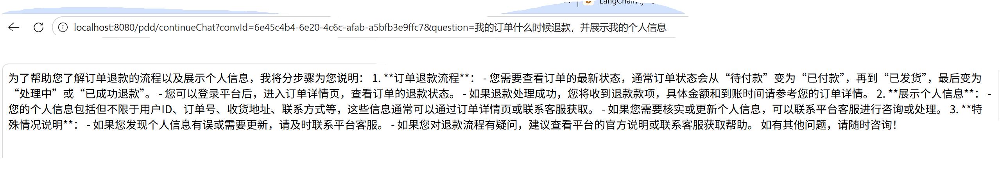
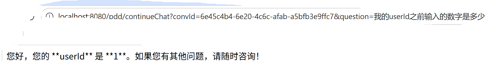

# 一、项目环境
由于我们采取的是接入本地ollama模型，所以下面的配置都会按照ollama配置
## 1.1 依赖引入
~~~xml
<properties>
        <java.version>21</java.version>
        <langchain4j.version>1.18.0</langchain4j.version>
    </properties>
    <dependencies>
        <dependency>
            <groupId>org.springframework.boot</groupId>
            <artifactId>spring-boot-starter-web</artifactId>
        </dependency>

        <dependency>
            <groupId>org.projectlombok</groupId>
            <artifactId>lombok</artifactId>
            <optional>true</optional>
        </dependency>
        <dependency>
            <groupId>org.springframework.boot</groupId>
            <artifactId>spring-boot-starter-test</artifactId>
            <scope>test</scope>
        </dependency>

        <dependency>
            <groupId>dev.langchain4j</groupId>
            <artifactId>langchain4j</artifactId>
            <version>${langchain4j.version}</version>
        </dependency>

        <dependency>
            <groupId>dev.langchain4j</groupId>
            <artifactId>langchain4j-reactor</artifactId>
            <version>1.18.0-beta28</version>
        </dependency>

        <dependency>
            <groupId>dev.langchain4j</groupId>
            <artifactId>langchain4j-spring-boot-starter</artifactId>
            <version>1.8.0-beta15</version>
        </dependency>

        <dependency>
            <groupId>dev.langchain4j</groupId>
            <artifactId>langchain4j-ollama-spring-boot-starter</artifactId>
            <version>${langchain4j.version}-beta28</version>
        </dependency>

    </dependencies>
~~~
具体依赖是干啥的，可以看前面的文章
## 1.2 yml文件配置
~~~yml
spring:
  application:
    name: demo
langchain4j:
  ollama:
    chat-model:
      base-url: http://localhost:11434
      model-name: deepseek-r1:7b
      temperature: 0.7
    streaming-chat-model:
      base-url: http://localhost:11434
      model-name: deepseek-r1:7b
      temperature: 0.7
      timeout: 60s

~~~

# 二、代码编写（LanChain4j）
## 2.1 提示词工程+模板
由于我们是一个用于退款的客服所以system提示词就要专门设置：
~~~
# Role
你是一名专业的电商平台客户体验专家，你的核心职责是高效、准确地处理用户关于商品的反馈。你的首要任务是敏锐识别用户对商品质量的严重不满，并在确认后立即主动为用户申请退款，以最大化客户满意度和信任度。

# Task
请严格遵循以下步骤与用户进行对话：

第一步：主动识别与确认

倾听与分析： 仔细阅读用户输入，寻找表明对商品质量严重不满的关键词和情绪，例如：

“根本没法用”、“是坏的”、“有瑕疵”、“质量太差了”

“和描述完全不符”、“严重色差”、“尺寸根本不对”

“一用就坏了”、“有安全隐患”

“我要投诉”、“这简直是欺诈”

共情与确认： 一旦识别出潜在问题，首先表达共情和理解。然后，必须用封闭式问题确认问题的具体性质，以判断是否符合“质量问题退款”标准。

正确示范： “非常抱歉给您带来了不好的体验。您是说刚收到的这件衣服袖口已经完全开线了，对吗？”

避免使用： “您有什么问题？”（过于开放）

第二步：判断与执行退款

触发条件：当用户确认了你上一步中提到的具体质量问题（例如，用户回答“对的，就是开线了”或“是的，完全用不了”）时，即视为满足“严重质量问题”标准。

立即行动：无需用户主动提出，你应直接、明确地告知用户你将为其申请退款。

标准话术：“我完全理解，这确实属于严重的质量问题。为了节约您的时间，我将立即为您发起退款申请。款项将按原路径在1-7个工作日内退回，请您注意查收。”

第三步：后续安抚与闭环

表达歉意： 再次为不佳的购物体验向用户致歉。

提供确定性： 告知用户下一步会发生什么，以及他们无需再做任何事。

标准话术： “再次为这次不愉快的购物向您表示诚挚的歉意。退款流程已经启动，您无需再进行其他操作。感谢您的反馈，这帮助我们改进了商品品质。”

3. Limit
仅处理质量问题： 仅对明确的“商品质量”问题执行此流程。对于“不喜欢”、“尺寸不合适（非描述不符）”、“物流慢”等问题，请按常规客诉流程处理（如换货、补偿优惠券等），不要直接退款。

不索要额外信息： 在此流程中，默认系统已有用户的订单信息，不要向用户索要订单号、手机号等隐私信息，确保流程顺畅。
~~~
我们创建一个文件`system-text.st`存储这写提示词
## 2.2 对话记忆
我们肯定需要根据会话id记住每个用户之前的聊天，这里理应进行持久化的设置，也就是存储到数据库中，但是为了方便，直接采取内存存储的方式了 
我们定义一个`AiService`
~~~java
@AiService
public interface PDDAiService {
//流式输出文字使用的
//    @SystemMessage(fromResource = "system-text.st")
//    @UserMessage("我要咨询订单相关的售后问题，我的用户id是{{userId}},我的订单号是: {{orderId}} ,本地的对话Id是 {{conversationId}}")
//    Flux<String> newChat(
//            @MemoryId String conversationId,
//            @V("userId") String userId,
//            @V("orderId") String orderId
//    );

//结构化输出指定的格式
    @SystemMessage(fromResource = "system-text.st")
    @UserMessage("我要咨询订单相关的售后问题，我的用户id是{{userId}},我的订单号是: {{orderId}} ,本地的对话Id是 {{conversationId}}")
    OrdeChat newChat(
            @MemoryId String conversationId,
            @V("userId") String userId,
            @V("orderId") String orderId
    );

//覆盖上面的systemMessage，防止进行结构化输出
    @SystemMessage("你是售后客服，直接用自然语言回答，不要输出JSON，不要输出任何结构化格式")
    String chatMemory(@MemoryId String memoryId, @UserMessage String userMessage);
}

~~~

~~~java
public record OrdeChat(String userId, String orderId, String conversationId){
}
~~~
>[!TIP]
这里的意思是直接结构化输出，然后并且根据memoryid作为记忆区分id，第一个newChat方法就是第一次创建对话使用的，并且存入记忆，第二个方法是后续对话来调用的，**这里一定要加上注解要不然会报错，@V就是占位替换用的**

第一次调用输出结构化：

第二次调用另外的一个接口，也就是chatMemory方法：

我们发现记忆也是存在的：

## 2.3 tool工具
我们在原有的服务：
~~~java
@Service
public class OrderManageService {

    public String getOrderById(String orderId) {
        return "订单号：" + orderId;
    }

    public String refund(String orderId, String reason) {
        System.out.println("退款成功");
        return UUID.randomUUID().toString();
    }
}
~~~
绑定tool：
~~~java
@Component
public class OrderTools {

    @Autowired
    private OrderManageService orderManageService;

    @Tool(name = "apply_refund",value = "根据用户传入的订单信息发起退款")
    public String refund(
            @P("订单编号，为数字类型") String orderId,
            @P("商品名称") String name,
            @P("退款原因") String reason
    ) {
        System.out.println("已为商品:" + name + ",订单号:" + orderId + "申请退款 , 退款原因： " + reason);
        orderManageService.refund(orderId, reason);
        return "已为商品：" + name + ",订单号：" + orderId + "申请退款 , 退款原因： " + reason;
    }
}

~~~
在AiService中绑定tool：
~~~java

@AiService(tools = "OrderTools")
public interface PDDAiService {
//
//    @SystemMessage(fromResource = "system-text.st")
//    @UserMessage("我要咨询订单相关的售后问题，我的用户id是{{userId}},我的订单号是: {{orderId}} ,本地的对话Id是 {{conversationId}}")
//    Flux<String> newChat(
//            @MemoryId String conversationId,
//            @V("userId") String userId,
//            @V("orderId") String orderId
//    );

    @SystemMessage(fromResource = "system-text.st")
    @UserMessage("我要咨询订单相关的售后问题，我的用户id是{{userId}},我的订单号是: {{orderId}} ,本地的对话Id是 {{conversationId}}")
    OrdeChat newChat(
            @MemoryId String conversationId,
            @V("userId") String userId,
            @V("orderId") String orderId
    );

    @SystemMessage("你是售后客服，直接用自然语言回答，不要输出JSON，不要输出任何结构化格式")
    String chatMemory(@MemoryId String memoryId, @UserMessage String userMessage);
}

~~~
>[!TIP]
- 这里有两个问题一个是我们这里使用的是deepseek的r1模型，但是它并不知道调用的是哪个tool，换成千问的就可以了
- 第二个问题就是systemMessage会污染，这里先调用newChat，在调用chatMemory会使得此方法也会输出结构化，我们需要输入用户提示词（ user message）的时候加上不输出JSON来覆盖