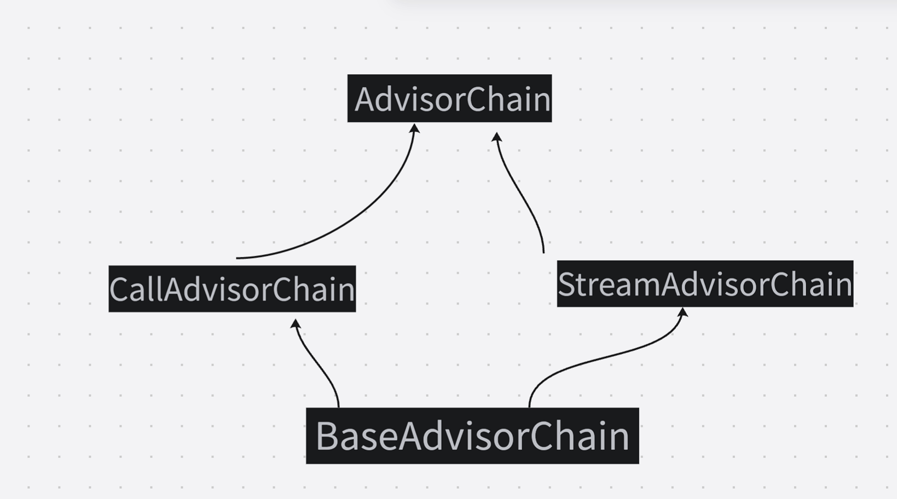
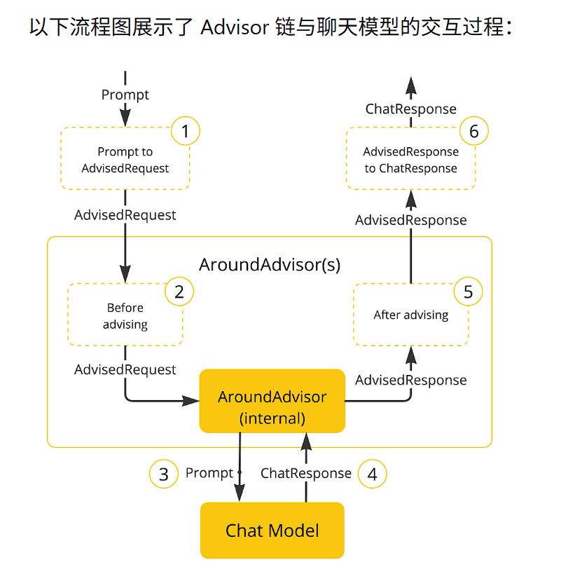

# Advisor API

## 一、Advisor定义

Advisor 是 Spring AI 的**拦截增强切面机制**，类似 AOP，在 ChatClient 与 LLM 交互的请求前、响应后做拦截修改，支持同步 / 流式两条链路Spring

## 二、核心组件

### 2.1 顶层基础接口

Advisor是顶层接口

~~~java
public interface Advisor extends Ordered {
    String getName(); // 获取Advisor唯一名称
    int getOrder();   // Ordered，定义链中执行顺序，越小越先执行
}
~~~

>[!TIP]
所有的advisor都会继承它，getName用来识别、日志。

### 2.2 两条核心分支接口（同步 / 流式）

#### 同步非流式：`Calldvisor` extends Advisor

~~~java
public interface CallAdvisor extends Advisor {
    ChatClientResponse adviseCall(ChatClientRequest chatClientRequest, CallAdvisorChain callAdvisorChain);
}
~~~

- `ChatClientRequest`：**可修改的请求体**（prompt、chatOptions、adviseContext 上下文），unsealed 未提交给模型
- `CallAdvisorChain`：调用 `chain. nextCall()` 执行链中下一个 Advisor；不调用 next 就阻断请求
- 返回 `ChatClientResponse`：模型响应，可修改后返回上游

对于`CallAdvisorChain`：

~~~java
public interface CallAdvisorChain extends AdvisorChain {
    ChatClientResponse nextCall(ChatClientRequest chatClientRequest);

    List<CallAdvisor> getCallAdvisors();

    CallAdvisorChain copy(CallAdvisor after);
}

~~~

我们可以发现`nextCall`就是负责调用下一个advisor的：

~~~java
 public ChatClientResponse nextCall(ChatClientRequest chatClientRequest) {
        Assert.notNull(chatClientRequest, "the chatClientRequest cannot be null");
        if (this.callAdvisors.isEmpty()) {
            throw new IllegalStateException("No CallAdvisors available to execute");
        } else {
            CallAdvisor advisor = (CallAdvisor)this.callAdvisors.pop();
            AdvisorObservationContext observationContext = AdvisorObservationContext.builder().advisorName(advisor.getName()).chatClientRequest(chatClientRequest).order(advisor.getOrder()).build();
            return (ChatClientResponse)AdvisorObservationDocumentation.AI_ADVISOR.observation(this.observationConvention, DEFAULT_OBSERVATION_CONVENTION, () -> observationContext, this.observationRegistry).observe(() -> {
                ChatClientResponse chatClientResponse = advisor.adviseCall(chatClientRequest, this);
                observationContext.setChatClientResponse(chatClientResponse);
                return chatClientResponse;
            });
        }
    }
~~~

>[!NOTE]
这里private final Deque<CallAdvisor> callAdvisors;是一个队列所以要pop取出下一个advisor

我们可以发现下面这两行代码通过调用`adviseCall`获取响应然后设置到上下文中，而这个`adviosr`就是`Calladviosr`类型的。这也就达到了一个个advisor接续执行的效果

~~~java
ChatClientResponse chatClientResponse = advisor.adviseCall(chatClientRequest, this);
observationContext.setChatClientResponse(chatClientResponse);
~~~

在`adviseCall`中，继承`Calldvisor`会重写此方法并加入此advisor所需要实现的功能： 
`BaseAdvisor`继承后：

~~~java
default ChatClientResponse adviseCall(ChatClientRequest chatClientRequest, CallAdvisorChain callAdvisorChain) {
        Assert.notNull(chatClientRequest, "chatClientRequest cannot be null");
        Assert.notNull(callAdvisorChain, "callAdvisorChain cannot be null");
        ChatClientRequest processedChatClientRequest = this.before(chatClientRequest, callAdvisorChain);
        ChatClientResponse chatClientResponse = callAdvisorChain.nextCall(processedChatClientRequest);
        return this.after(chatClientResponse, callAdvisorChain);
}
~~~

>[!NOTE]
注意这里的before跟after方法类似AOP机制，具体的before跟after逻辑需要具体的advisor去重写此方法

`SimpleLoggerAdvisor`直接实现`CallAdvisor`：

~~~java
 public ChatClientResponse adviseCall(ChatClientRequest chatClientRequest, CallAdvisorChain callAdvisorChain) {
        this.logRequest(chatClientRequest);
        ChatClientResponse chatClientResponse = callAdvisorChain.nextCall(chatClientRequest);
        this.logResponse(chatClientResponse);
        return chatClientResponse;
    }
~~~

>[!NOTE]
这里的`logRequest`,`logResponse`实现的效果就像是before跟after

#### 流式：`StreamAdvisor` extends Advisor

剩下的逻辑跟非流式是一致的，名称也类似

~~~java
 Flux<ChatClientResponse> adviseStream(ChatClientRequest chatClientRequest, StreamAdvisorChain streamAdvisorChain);
~~~

- 流式返回 `Flux<ChatClientResponse>`，适配大模型流式输出场景
- `StreamAdvisorChain.nextStream(request)` 继续执行链路

注意的是以上都是新版本（2.0+）的版本，旧版本有所差别

### 2.3 核心分支链接口

最上面是顶层接口，最下面的统一实现call跟stream的方法 
调用逻辑就是上面的逻辑：

#### `CallAdvisorChain`

~~~java
public interface CallAdvisorChain extends AdvisorChain {
    ChatClientResponse nextCall(ChatClientRequest chatClientRequest);

    List<CallAdvisor> getCallAdvisors();

    CallAdvisorChain copy(CallAdvisor after);
}

~~~

#### `StreamAdvisorChain`

~~~java
public interface StreamAdvisorChain extends AdvisorChain {
    Flux<ChatClientResponse> nextStream(ChatClientRequest chatClientRequest);

    List<StreamAdvisor> getStreamAdvisors();
}

~~~

### 2.4 数据模型类

- `ChatClientRequest`：待发送给模型的请求，包含 Prompt、ChatOptions、`adviseContext`（Map，Advisor 之间共享状态），**可修改 prompt**
- `ChatClientResponse`：模型返回结果，包装 ChatResponse + `adviseContext`
- `AdvisorContext`：贯穿整个 Advisor 链的共享上下文，跨 Advisor 传递自定义参数（非常关键）

### 2.5 内置Advisor类

1. **`MessageChatMemoryAdvisor`**：对话记忆，加载历史消息追加进 Prompt，实现多轮对话
2. **`QuestionAnswerAdvisor`**：RAG 检索增强，向量库检索相关文档注入 prompt
3. **`ToolCallingAdvisor`**：工具调用 Advisor，处理 function call 循环调用（Spring AI2.0 后工具调用逻辑迁移到 Advisor）
4. **`LoggingAdvisor`**：打印请求 / 响应日志，调试使用
5. **`TokenCountAdvisor`**：统计 token，做长度校验、限流
6. **`GuardrailsAdvisor`**：输入输出内容审核，安全护栏

## 三、执行流程

- prompt请求进入后，在chatmodel调用LLM之前，会被写成一个`AdvisedRequest`类，并创建空的`AdvisorContext`，本质就是map<String,object>。来实现共享上下文。
- 然后经过设定好的顺序或者依据类似栈的规则，后链首advisor先生效，advisor可以选择放行也可中断请求。
- 调用LLM后返回的请求，再次经历advisor，默认是栈，链末的最先执行，返回的是一个`AdvisedResonse`里面包含`AdvisorContext`,以及`ChatResponce`；

## 四、实现Advisor

创建 `Advisor` 需实现 `CallAdvisor` 或 `StreamAdvisor`（或两者）。核心实现方法是：非流式用 `nextCall()` ，流式用 `nextStream()`。

上下文修改的实例：
