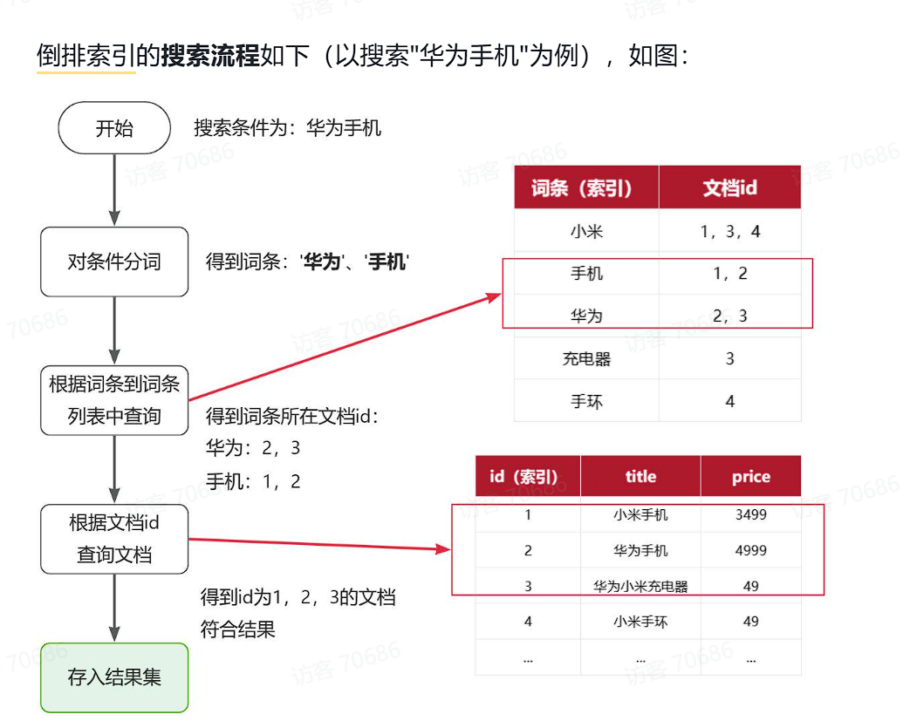
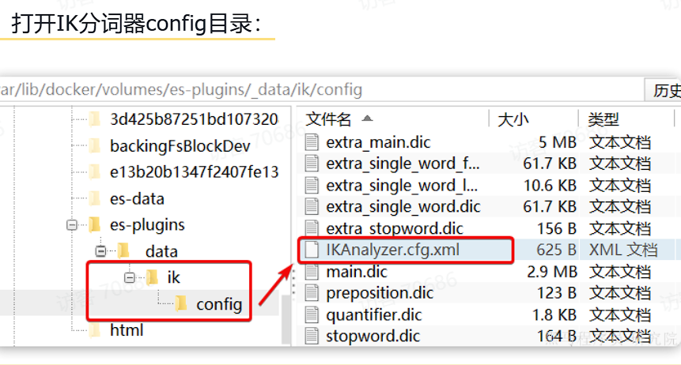

# 一、认识Elasticsearch（简称ES）

## 1.1 定义

Elasticsearch是由elastic公司开发的一套搜索引擎技术，它是elastic技术栈中的一部分。完整的技术栈包括：

- `Elasticsearch`：用于数据存储、计算和搜索
- `Logstash/Beats`：用于数据收集
- `Kibana`：用于数据可视化
整套技术栈被称为ELK，经常用来做日志收集、系统监控和状态分析等等

## 1.2 安装ES跟Kibana

- `elasticsearch`：存储、搜索和运算
- `kibana`：图形化展示

### Kibana简介

就是给ES提供的一个可视化图形化工具，Elasticsearch对外提供的是Restful风格的API，任何操作都可以通过发送http请求来完成，而Kibana就简化了操作。 

Kibana是elastic公司提供的用于操作Elasticsearch的可视化控制台。它的功能非常强大，包括：

- 对Elasticsearch数据的搜索、展示
- 对Elasticsearch数据的统计、聚合，并形成图形化报表、图形
- 对Elasticsearch的集群状态监控
- 它还提供了一个开发控制台（DevTools），在其中对Elasticsearch的Restful的API接口提供了语法提示

### ES的Docker部署

~~~Bash
docker run -d \
  --name es \ #容器名
  -e "ES_JAVA_OPTS=-Xms512m -Xmx512m" \ #设置内存大小，不设置默认1g
  -e "discovery.type=single-node" \
  -v es-data:/usr/share/elasticsearch/data \  #数据卷挂载
  -v es-plugins:/usr/share/elasticsearch/plugins \  #插件挂载，比如后面的IK
  --privileged \
  --network hm-net \ #docker内部容器间的网
  -p 9200:9200 \
  -p 9300:9300 \
  elasticsearch:7.12.1  # 版本
~~~

### Kibana的Docker部署

~~~Bash
docker run -d \
--name kibana \
-e ELASTICSEARCH_HOSTS=http://es:9200 \ # 访问ES的地址
--network=hm-net \
-p 5601:5601  \
kibana:7.12.1
~~~

## 1.3 倒排索引

ES采取的是倒排索引，相比于`MySQL`的正向索引，面对模糊查询就需要遍历整个数据库，倒排索引明显更快。

### 关键概念

- 文档（Document）：用来搜索的数据，其中的每一条数据就是一个文档。例如一个网页、一个商品信息
- 词条（Term）：对文档数据或用户搜索数据，利用某种算法分词，得到的具备含义的词语就是词条。例如：为祖国添砖JAVA，就可以分成，为，祖国，添砖，JAVA这些词条 

创建倒排索引是对正向索引的一种特殊处理和应用，流程如下：

- 将每一个文档的数据利用分词算法根据语义拆分，得到一个个词条
- 创建表，每行数据包括词条、词条所在文档id、位置等信息
- 因为词条唯一性，可以给词条创建正向索引
此时形成的这张以词条为索引的表，就是倒排索引表

>[!TIP]
这也一来，我们就有一个表，记录了词条对应的原先数据的索引

### 流程

## 1.4 基本概念

跟`MySQL`相似，但也有差别

### 1.4.1 文档和字段

elasticsearch是面向文档（Document）存储的，可以是数据库中的一条商品数据，一个订单信息。文档数据会被序列化为json格式后存储在elasticsearch中：

~~~JSON
{
    "id": 1,
    "title": "小米手机",
    "price": 3499
}
{
    "id": 2,
    "title": "华为手机",
    "price": 4999
}
{
    "id": 3,
    "title": "华为小米充电器",
    "price": 49
}
{
    "id": 4,
    "title": "小米手环",
    "price": 299
}
~~~

可见，数据库中的一行就是这里一段JSON，也就是文档，这里就有四个文档，数据库里的一列就是这里的一个Field字段

### 1.4.2 索引和映射

- 索引：ES是通过索引，将文档进行分类存储，有点像数据库中的table表
- 映射：用来定义表的结构、字段的名称、类型等信息。因此，索引库中就有映射（mapping），是索引中文档的字段约束信息，类似表的结构约束。

>[!TIP]
`MySQL`更安全，`ES`更高效

## 1.5 IK分词器

Elasticsearch的关键就是倒排索引，而倒排索引依赖于对文档内容的分词，而分词则需要高效、精准的分词算法，IK分词器就是这样一个中文分词算法。

### 安装IK

~~~Bash
docker exec -it es ./bin/elasticsearch-plugin  install https://github.com/medcl/elasticsearch-analysis-ik/releases/download/v7.12.1/elasticsearch-analysis-ik-7.12.1.zip
~~~

安装到es的插件挂卷处

### 使用IK分词器

- ik_smart：智能语义切分
- ik_max_word：最细粒度切分
我们在`Kibana`中的devTool使用：

~~~JSON
POST /_analyze
{
  "analyzer": "ik_smart", //这里切换模式
  "text": "学习java太棒了"
}
~~~

### 扩展词典

由于这个IK算法分词并不一定识别出网络热词或者最近的一些公司名等，这是我们就要手动添加进入词典中

~~~xml
<?xml version="1.0" encoding="UTF-8"?>
<!DOCTYPE properties SYSTEM "http://java.sun.com/dtd/properties.dtd">
<properties>
        <comment>IK Analyzer 扩展配置</comment>
        <!--用户可以在这里配置自己的扩展字典 *** 添加扩展词典-->
        <entry key="ext_dict">ext.dic</entry>
</properties>
~~~

然后创建一个ext.dic的文件，里面写入自己不想拆开的词语，记得重启es容器

# 二、索引库操作

## 2.1 Mapping映射字段

Mapping是对索引库中文档的约束，常见的Mapping属性包括：

- type：字段数据类型，常见的简单类型有：
  - 字符串：text（可分词的文本）、keyword（精确值，例如：品牌、国家、ip地址）
  - 数值：long、integer、short、byte、double、float、
  - 布尔：boolean
  - 日期：date
  - 对象：object
- index：是否创建索引，默认为true
- analyzer：使用哪种分词器
- properties：该字段的子字段
这个操作就等于是对于数据库中每个字段设置类型，主键的操作

## 2.2 索引的CRUD操作

由于Elasticsearch采用的是Restful风格的API，因此其请求方式和路径相对都比较规范，而且请求参数也都采用JSON风格。
我们直接基于Kibana的DevTools来编写请求做测试

### 2.2.1 索引库的创建，Mapping映射字段

基本语法：

- 请求方式：PUT
- 请求路径：/索引库名，可以自定义
- 请求参数：mapping映射

~~~JSON
PUT /索引库名称
{
  "mappings": {
    "properties": {
      "字段名":{
        "type": "text",
        "analyzer": "ik_smart"
      },
      "字段名2":{
        "type": "keyword",
        "index": "false"
      },
      "字段名3":{
        "properties": {
          "子字段": {
            "type": "keyword"
          }
        }
      },
      // ...略
    }
  }
}
~~~

**创建索引（定义表结构），只规定字段、类型、分词器**不插入任何业务数据。

>[!NOTE]
有些字段名没有指定分词器，并不意味着不会被es查到，因为默认是es的标准分词器，只有index属性标记为false，才不会查到，因为不会生成索引

### 2.2.2 索引库查询

基本语法：

- 请求方式：GET
- 请求路径：/索引库名
- 请求参数：无
-  

~~~
GET /索引库名
~~~

### 2.2.3 索引库的删除

语法：

- 请求方式：DELETE
- 请求路径：/索引库名
- 请求参数：无
-  

~~~
DELETE /索引库名
~~~

### 2.2.4 修改索引库

由于倒排索引，我们无法修改mapping映射字段，因为每改一次就会重新分词，但是我们可以新增映射字段 

~~~JSON
PUT /索引库名/_mapping  //注意_mapping
{
  "properties": {
    "新字段名":{
      "type": "integer"
    }
  }
}
~~~

## 2.3 文档操作

这一步就是对上面建立的索引库中**文档**（数据）进行修改，类似于sql建表后，对里面的数据进行修改

### 2.3.1 新增文档

~~~
POST /索引库名/_doc/文档id  //这里的文档id就类似于mysql中的每一行的index
{
    "字段1": "值1",
    "字段2": "值2",
    "字段3": {
        "子属性1": "值3",
        "子属性2": "值4"
    },
}
~~~

### 2.3.2 查询文档

~~~
GET /{索引库名称}/_doc/{id}
~~~

### 2.3.3 删除文档

~~~
DELETE /{索引库名}/_doc/id值
~~~

### 2.3.4 修改文档

分为：

- 全量修改：直接覆盖原来的文档
- 局部修改：修改文档中的部分字段

#### 全量修改put

它会删除原来的文档，然后执行修改的内容

~~~
PUT /{索引库名}/_doc/文档id
{
    "字段1": "值1",
    "字段2": "值2",
    // ... 略
}
~~~

>[!NOTE]
如果id不存在，就会直接新建一个文档

#### 局部修改

不会删除，直接修改定义的部分

~~~
POST /{索引库名}/_update/文档id
{
    "doc": {
         "字段名": "新的值",
    }
}
~~~

### 2.3.5 批量处理操作

~~~JSON
POST _bulk
{ "index" : { "_index" : "test", "_id" : "1" } }
{ "field1" : "value1" }
{ "delete" : { "_index" : "test", "_id" : "2" } }
{ "create" : { "_index" : "test", "_id" : "3" } }
{ "field1" : "value3" }
{ "update" : {"_id" : "1", "_index" : "test"} }
{ "doc" : {"field2" : "value2"} }
~~~

- index代表新增操作
  - _index：指定索引库名
  - _id指定要操作的文档id
  - { "field1" : "value1" }：则是要新增的文档内容
- delete代表删除操作
  - _index：指定索引库名
  - _id指定要操作的文档id
- update代表更新操作
  - _index：指定索引库名
  - _id指定要操作的文档id
  - { "doc" : {"field2" : "value2"} }：要更新的文档字段

>[!TIP]
在devTool中对于每一个操作，变更的文档都要写在同一行，不要分行写

# 三、SpringBoot中使用

## 3.1 索引库操作

### 3.1.1 初始化RestClient

在elasticsearch提供的API中，与elasticsearch一切交互都封装在一个名为RestHighLevelClient的类中，必须先完成这个对象的初始化，建立与elasticsearch的连接。

#### 依赖配置

~~~xml
<dependency>
    <groupId>org.elasticsearch.client</groupId>
    <artifactId>elasticsearch-rest-high-level-client</artifactId>
</dependency>
~~~

#### 初始化

~~~java
RestHighLevelClient client = new RestHighLevelClient(RestClient.builder(
        HttpHost.create("地址")
));
~~~

### 3.1.2 创建索引库

利用`CreateIndexRequest`类，`indices`方法返回的是很多方法，其中`create`就是一个

~~~java
  // 1.创建Request对象
    CreateIndexRequest request = new CreateIndexRequest("items");
    // 2.准备请求参数
    request.source(MAPPING_TEMPLATE, XContentType.JSON);//第一个是自定义的字符串，是创建索引库的指令，第二个参数代表类型是JSON
    // 3.发送请求
    client.indices().create(request, RequestOptions.DEFAULT);
~~~

### 3.1.3 删除索引库

~~~java
    // 1.创建Request对象
    DeleteIndexRequest request = new DeleteIndexRequest("items");
    // 2.发送请求
    client.indices().delete(request, RequestOptions.DEFAULT);
~~~

### 3.1.4 查询索引库

~~~java
 // 1.创建Request对象
    GetIndexRequest request = new GetIndexRequest("items");
    // 2.发送请求
    boolean exists = client.indices().exists(request, RequestOptions.DEFAULT);
~~~

## 3.2 文档操作

### 3.2.1 新增文档

~~~java
@Test
void testIndexDocument() throws IOException {
    // 1. 创建 IndexRequest 对象，指定索引库名 indexName，文档id=1
    IndexRequest request = new IndexRequest("indexName").id("1");

    // 2. 设置文档JSON内容，指定数据类型为JSON
    request.source("{\"name\": \"Jack\", \"age\": 21}", XContentType.JSON);

    // 3. 客户端发送请求，执行新增（覆盖）文档
    client.index(request, RequestOptions.DEFAULT);
}
// \是转义“”用的
~~~

### 3.2.2 查询文档

~~~java
  // 1.准备Request对象
    GetRequest request = new GetRequest("items").id("100002644680");
    // 2.发送请求
    GetResponse response = client.get(request, RequestOptions.DEFAULT);
    // 3.获取响应结果中的source
    String json = response.getSourceAsString();
    //将json转成自定义的类
    ItemDoc itemDoc = JSONUtil.toBean(json, ItemDoc.class);
~~~

### 3.2.3 删除文档

~~~java
// 1.准备Request，两个参数，第一个是索引库名，第二个是文档id
    DeleteRequest request = new DeleteRequest("item", "100002644680");
    // 2.发送请求
    client.delete(request, RequestOptions.DEFAULT);
~~~

### 3.2.4 修改文档

全局修改就是上面的新增，下面是局部修改

~~~java
   // 1.准备Request
    UpdateRequest request = new UpdateRequest("items", "100002644680");
    // 2.准备请求参数
    request.doc(
            "price", 58800,
            "commentCount", 1
    );
    // 3.发送请求
    client.update(request, RequestOptions.DEFAULT);
~~~

### 3.2.5 批量操作文档

~~~java
  // 1.创建Request
    BulkRequest request = new BulkRequest();
    // 2.准备请求参数
    request.add(new IndexRequest("items").id("1").source("json doc1", XContentType.JSON));
    request.add(new IndexRequest("items").id("2").source("json doc2", XContentType.JSON));
    // 3.发送请求
    client.bulk(request, RequestOptions.DEFAULT);
~~~

# 四、Elasticsearch DSL语句

我们可以发现上面的查询都是按照索引id查询，如何进行模糊呢，就需要ES的DSL了

## 4.1 什么是DSL

DSL = Domain Specific Language，领域专用语言

## 4.2 定义

Elasticsearch的查询可以分为两大类：

- 叶子查询（Leaf query clauses）：一般是在特定的字段里查询特定值，属于简单查询，很少单独使用。
- 复合查询（Compound query clauses）：以逻辑方式组合多个叶子查询或者更改叶子查询的行为方式。

## 4.3 快速入门

~~~JSON
GET /{索引库名}/_search
{
  "query": {
    "查询类型": {
      // .. 查询条件
    }
  }
}
~~~

## 4.4 叶子查询

叶子查询的类型也可以做进一步细分，这里只介绍常见的三种

### 1.全文检索查询

~~~JSON
GET /{索引库名}/_search
{
  "query": {
    "match": {
      "字段名": "搜索条件"
    }
  }
}
~~~

这里是根据多字段去查询，所以相比较上面的就会出现性能上的不足

~~~JSON
GET /{索引库名}/_search
{
  "query": {
    "multi_match": {
      "query": "搜索条件",
      "fields": ["字段1", "字段2"]
    }
  }
}
~~~

### 2.精确查询

就是不会进行分词操作，之间按照这个词语进行查询，因此推荐查找keyword、数值、日期、boolean类型的字段

~~~JSON
GET /{索引库名}/_search
{
  "query": {
    "term": {
      "字段名": {
        "value": "搜索条件"
      }
    }
  }
}
~~~

>[!TIP]
这里term表示精确查询，不进行分词操作，与match等平级

~~~JSON
GET /{索引库名}/_search
{
  "query": {
    "range": {
      "字段名": {
        "gte": {最小值},
        "lte": {最大值}
      }
    }
  }
}
~~~

## 4.5 复合查询

复合查询大致可以分为两类：

- 第一类：基于逻辑运算组合叶子查询，实现组合条件，例如
  - bool
- 第二类：基于某种算法修改查询时的文档相关性算分，从而改变文档排名。例如：
  - function_score
  - dis_max
这里只介绍第一类

### bool查询

bool查询支持的逻辑运算有：

- must：必须匹配每个子查询，类似“与”
- should：选择性匹配子查询，类似“或”
- must_not：必须不匹配，不参与算分，类似“非”
- filter：必须匹配，不参与算分
 

注意的是这里请求路径的_search是必备的

~~~JSON
GET /items/_search
{
  "query": {
    "bool": {
      "must": [
        {"match": {"name": "手机"}}
      ],
      "should": [
        {"term": {"brand": { "value": "vivo" }}},
        {"term": {"brand": { "value": "小米" }}}
      ],
      "must_not": [
        {"range": {"price": {"gte": 2500}}}
      ],
      "filter": [
        {"range": {"price": {"lte": 1000}}}
      ]
    }
  }
}
~~~

## 4.6 排序

注意的是这里请求路径的_search是必备的

~~~JSON
GET /indexName/_search
{
  "query": {
    "match_all": {}
  },
  "sort": [
    {
      "排序字段": {
        "order": "排序方式asc和desc"
      }
    }
  ]
}
~~~

## 4.7 分页

### 4.7.1 基础分页

elasticsearch中通过修改from、size参数来控制要返回的分页结果：

- from：从第几个文档开始
- size：总共查询几个文档
类似于mysql中的limit ?, ?

~~~JSON
GET /items/_search
{
  "query": {
    "match_all": {} //这里也可以换成match等
  },
  "from": 0, // 分页开始的位置，默认为0
  "size": 10,  // 每页文档数量，默认10
  "sort": [
    {
      "price": {
        "order": "desc"
      }
    }
  ]
}
~~~

### 4.7.2 深度分页

elasticsearch的数据一般会采用分片存储，也就是把一个索引中的数据分成N份，存储到不同节点上。这种存储方式比较有利于数据扩展，但给分页带来了一些麻烦。
 
比如我们如果要查询1000-1050中的数据，就需要全部查询找出这个区间的数据排名，然后汇总，返回，这也就会大大影响性能
 
由此可知，当查询分页深度较大时，汇总数据过多，对内存和CPU会产生非常大的压力。
因此elasticsearch会禁止from+ size 超过10000的请求。

针对深度分页，elasticsearch提供了两种解决方案：

- search after：分页时需要排序，原理是从上一次的排序值开始，查询下一页数据。官方推荐使用的方式。
- scroll：原理将排序后的文档id形成快照，保存下来，基于快照做分页。官方已经不推荐使用。

## 4.8 高亮显示

### 4.8.1 什么是高亮

就是我们在搜索时，输入的关键字会在搜索出的结果里以红色或者其它的颜色标注出来

### 4.8.2 高亮的原理

就是在检索关键字的时候会将查询到的关键字打上标签，该标签在前端设置了css样式，显示红色等颜色

### 4.8.3 DSL语句

~~~JSON
GET /{索引库名}/_search
{
  "query": {
    "match": {
      "搜索字段": "搜索关键字"
    }
  },//下面就是提供的添加标签的固定语句
  "highlight": {
    "fields": {
      "高亮字段名称": {
        "pre_tags": "<em>",
        "post_tags": "</em>"
      }
    }
  }
}
~~~

>[!WARNING]

- 搜索必须有查询条件，而且是全文检索类型的查询条件，例如match
- 参与高亮的字段必须是text类型的字段
- 默认情况下参与高亮的字段要与搜索字段一致，除非添加：required_field_match=false

~~~JSON
GET /items/_search
{
  "query": {
    "match": {
      "title": "手机"
    }
  },
  "highlight": {
    "fields": {
      "title": {},
      "content": {}
    },
    "required_field_match": false
  }
}

~~~
