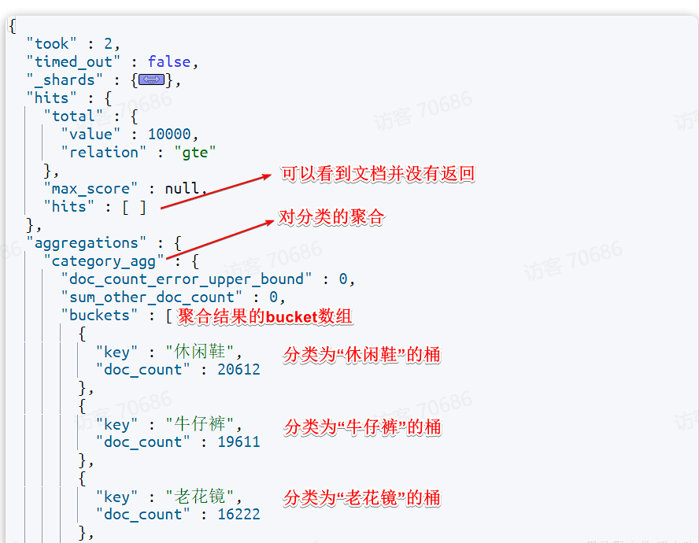

# 一、Elasticsearch DSL语句

我们可以发现之前的查询都是按照索引id查询，如何进行模糊呢，怎么进行排序呢，这时就需要ES的DSL了

## 1.1 什么是DSL

DSL = Domain Specific Language，领域专用语言

## 1.2 定义

Elasticsearch的查询可以分为两大类：

- 叶子查询（Leaf query clauses）：一般是在特定的字段里查询特定值，属于简单查询，很少单独使用。
- 复合查询（Compound query clauses）：以逻辑方式组合多个叶子查询或者更改叶子查询的行为方式。

## 1.3 快速入门

~~~JSON
GET /{索引库名}/_search
{
  "query": {
    "查询类型": {
      // .. 查询条件
    }
  }
}
~~~

## 1.4 叶子查询

叶子查询的类型也可以做进一步细分，这里只介绍常见的三种

### 1.全文检索查询

~~~JSON
GET /{索引库名}/_search
{
  "query": {
    "match": {
      "字段名": "搜索条件"
    }
  }
}
~~~

这里是根据多字段去查询，所以相比较上面的就会出现性能上的不足

~~~JSON
GET /{索引库名}/_search
{
  "query": {
    "multi_match": {
      "query": "搜索条件",
      "fields": ["字段1", "字段2"]
    }
  }
}
~~~

### 2.精确查询

就是不会进行分词操作，之间按照这个词语进行查询，因此推荐查找keyword、数值、日期、boolean类型的字段

~~~JSON
GET /{索引库名}/_search
{
  "query": {
    "term": {
      "字段名": {
        "value": "搜索条件"
      }
    }
  }
}
~~~

>[!TIP]
这里term表示精确查询，不进行分词操作，与match等平级

~~~JSON
GET /{索引库名}/_search
{
  "query": {
    "range": {
      "字段名": {
        "gte": {最小值},
        "lte": {最大值}
      }
    }
  }
}
~~~

## 1.5 复合查询

复合查询大致可以分为两类：

- 第一类：基于逻辑运算组合叶子查询，实现组合条件，例如
  - bool
- 第二类：基于某种算法修改查询时的文档相关性算分，从而改变文档排名。例如：
  - function_score
  - dis_max
这里只介绍第一类

### bool查询

bool查询支持的逻辑运算有：

- must：必须匹配每个子查询，类似“与”
- should：选择性匹配子查询，类似“或”
- must_not：必须不匹配，不参与算分，类似“非”
- filter：必须匹配，不参与算分
 

注意的是这里请求路径的_search是必备的

~~~JSON
GET /items/_search
{
  "query": {
    "bool": {
      "must": [
        {"match": {"name": "手机"}}
      ],
      "should": [
        {"term": {"brand": { "value": "vivo" }}},
        {"term": {"brand": { "value": "小米" }}}
      ],
      "must_not": [
        {"range": {"price": {"gte": 2500}}}
      ],
      "filter": [
        {"range": {"price": {"lte": 1000}}}
      ]
    }
  }
}
~~~

## 1.6 排序

注意的是这里请求路径的_search是必备的

~~~JSON
GET /indexName/_search
{
  "query": {
    "match_all": {}
  },
  "sort": [
    {
      "排序字段": {
        "order": "排序方式asc和desc"
      }
    }
  ]
}
~~~

## 1.7 分页

### 1.7.1 基础分页

elasticsearch中通过修改from、size参数来控制要返回的分页结果：

- from：从第几个文档开始
- size：总共查询几个文档
类似于mysql中的limit ?, ?

~~~JSON
GET /items/_search
{
  "query": {
    "match_all": {} //这里也可以换成match等
  },
  "from": 0, // 分页开始的位置，默认为0
  "size": 10,  // 每页文档数量，默认10
  "sort": [
    {
      "price": {
        "order": "desc"
      }
    }
  ]
}
~~~

### 1.7.2 深度分页

elasticsearch的数据一般会采用分片存储，也就是把一个索引中的数据分成N份，存储到不同节点上。这种存储方式比较有利于数据扩展，但给分页带来了一些麻烦。
 
比如我们如果要查询1000-1050中的数据，就需要全部查询找出这个区间的数据排名，然后汇总，返回，这也就会大大影响性能
 
由此可知，当查询分页深度较大时，汇总数据过多，对内存和CPU会产生非常大的压力。
因此elasticsearch会禁止from+ size 超过10000的请求。

针对深度分页，elasticsearch提供了两种解决方案：

- search after：分页时需要排序，原理是从上一次的排序值开始，查询下一页数据。官方推荐使用的方式。
- scroll：原理将排序后的文档id形成快照，保存下来，基于快照做分页。官方已经不推荐使用。

## 1.8 高亮显示

### 1.8.1 什么是高亮

就是我们在搜索时，输入的关键字会在搜索出的结果里以红色或者其它的颜色标注出来

### 1.8.2 高亮的原理

就是在检索关键字的时候会将查询到的关键字打上标签，该标签在前端设置了css样式，显示红色等颜色

### 1.8.3 DSL语句

~~~JSON
GET /{索引库名}/_search
{
  "query": {
    "match": {
      "搜索字段": "搜索关键字"
    }
  },//下面就是提供的添加标签的固定语句
  "highlight": {
    "fields": {
      "高亮字段名称": {
        "pre_tags": "<em>",
        "post_tags": "</em>"
      }
    }
  }
}
~~~

>[!WARNING]

- 搜索必须有查询条件，而且是全文检索类型的查询条件，例如match
- 参与高亮的字段必须是text类型的字段
- 默认情况下参与高亮的字段要与搜索字段一致，除非添加：required_field_match=false

~~~JSON
GET /items/_search
{
  "query": {
    "match": {
      "title": "手机"
    }
  },
  "highlight": {
    "fields": {
      "title": {},
      "content": {}
    },
    "required_field_match": false
  }
}

~~~

# 二、JAVAAPI调用

## 2.1 快速入门

### 发送请求

~~~java
public class EsSearchDemo {
    public void searchAll(RestHighLevelClient client) throws Exception {
        // 1. 创建SearchRequest，指定索引库名
        SearchRequest request = new SearchRequest("goods");

        // 2. 利用SearchSourceBuilder构建DSL
        SearchSourceBuilder sourceBuilder = new SearchSourceBuilder();
        // match_all 查询所有数据
        sourceBuilder.query(QueryBuilders.matchAllQuery());

        // 扩展：分页
        sourceBuilder.from(0);
        sourceBuilder.size(5);
        // 扩展：排序
        sourceBuilder.sort("price", SortOrder.DESC);

        request.source(sourceBuilder);

        // 3. 发送请求，得到SearchResponse响应
        SearchResponse response = client.search(request, RequestOptions.DEFAULT);

        // 解析response（遍历命中结果）
        response.getHits().forEach(hit -> {
            System.out.println(hit.getSourceAsString());
        });
    }
}
~~~

- 第一步，创建SearchRequest对象，指定索引库名
- 第二步，利用request.source()构建DSL，DSL中可以包含查询、分页、排序、高亮等
- query()：代表查询条件，利用QueryBuilders.matchAllQuery()构建一个match_all查询的DSL，这里包括了叶子查询，复合查询等
- 第三步，利用client.search()发送请求，得到响应

### 解析结果

~~~JSON
{
    "took" : 0,
    "timed_out" : false,
    "hits" : {
        "total" : {
            "value" : 2,
            "relation" : "eq"
        },
        "max_score" : 1.0,
        "hits" : [
            {
                "_index" : "heima",
                "_type" : "_doc",
                "_id" : "1",
                "_score" : 1.0,
                "_source" : {
                "info" : "Java讲师",
                "name" : "赵云"
                }
            }
        ]
    }
}
~~~

elasticsearch返回的结果是一个JSON字符串，结构包含：

- hits：命中的结果
  - total：总条数，其中的value是具体的总条数值
  - max_score：所有结果中得分最高的文档的相关性算分
  - hits：搜索结果的文档数组，其中的每个文档都是一个json对象
    - _source：文档中的原始数据，也是json对象 

我们得到的是一个`SearchResponse`类

~~~java
 SearchHits searchHits = response.getHits();
    // 1.获取总条数
    long total = searchHits.getTotalHits().value;
    System.out.println("共搜索到" + total + "条数据");
    // 2.遍历结果数组
    SearchHit[] hits = searchHits.getHits();
    for (SearchHit hit : hits) {
        // 3.得到_source，也就是原始json文档
        String source = hit.getSourceAsString();
        // 4.反序列化并打印,就是字符串转自定义的类
        ItemDoc item = JSONUtil.toBean(source, ItemDoc.class);
        System.out.println(item);}
~~~

## 2.2 叶子查询

上面提到`QueryBuilders`控制的查询类型，所以我们只对这里进行修改即可 
match查询：

~~~java
 // 1.创建Request
    SearchRequest request = new SearchRequest("items");
    // 2.组织请求参数
    request.source().query(QueryBuilders.matchQuery("name", "脱脂牛奶"));
    // 3.发送请求
    SearchResponse response = client.search(request, RequestOptions.DEFAULT);
~~~

`multi_match`：

~~~java
 // 1.创建Request
    SearchRequest request = new SearchRequest("items");
    // 2.组织请求参数
    request.source().query(QueryBuilders.multiMatchQuery("脱脂牛奶", "name", "category"));
    // 3.发送请求
    SearchResponse response = client.search(request, RequestOptions.DEFAULT);
~~~

`range`查询：

~~~java
 // 1.创建Request
    SearchRequest request = new SearchRequest("items");
    // 2.组织请求参数
    request.source().query(QueryBuilders.rangeQuery("price").gte(10000).lte(30000));
    // 3.发送请求
    SearchResponse response = client.search(request, RequestOptions.DEFAULT);
~~~

`term`查询：

~~~java
 // 1.创建Request
    SearchRequest request = new SearchRequest("items");
    // 2.组织请求参数
    request.source().query(QueryBuilders.termQuery("brand", "华为"));
    // 3.发送请求
    SearchResponse response = client.search(request, RequestOptions.DEFAULT);
~~~

## 2.3 复合查询

也是利用`QueryBuilder`来进行构建

~~~java
  // 1.创建Request
    SearchRequest request = new SearchRequest("items");
    // 2.组织请求参数
    // 2.1.准备bool查询
    BoolQueryBuilder bool = QueryBuilders.boolQuery();
    // 2.2.关键字搜索
    bool.must(QueryBuilders.matchQuery("name", "脱脂牛奶"));
    // 2.3.品牌过滤
    bool.filter(QueryBuilders.termQuery("brand", "德亚"));
    // 2.4.价格过滤
    bool.filter(QueryBuilders.rangeQuery("price").lte(30000));
    request.source().query(bool);
    // 3.发送请求
    SearchResponse response = client.search(request, RequestOptions.DEFAULT);
~~~

## 2.4 排序与分页

由于request.source是整个JSON的参数，所以我们在这里进行排序跟分页的设置，也就是跟query是平级的，而且不用担心被覆盖，都会按照定义顺序存储下来

~~~java
  int pageNo = 1, pageSize = 5;

    // 1.创建Request
    SearchRequest request = new SearchRequest("items");
    // 2.组织请求参数
    // 2.1.搜索条件参数
    request.source().query(QueryBuilders.matchQuery("name", "脱脂牛奶"));
    // 2.2.排序参数
    request.source().sort("price", SortOrder.ASC);//升序
    // 2.3.分页参数
    request.source().from((pageNo - 1) * pageSize).size(pageSize);
    // 3.发送请求
    SearchResponse response = client.search(request, RequestOptions.DEFAULT);
~~~

## 2.5 高亮

高亮也是在request.source定义的，只不过高亮条件要基于`HighlightBuilder`来构造，并且最后解析结果也是单独的一部分，在JSON中返回的结果中这一部分是以'highlight'与'source'是平等的，是两部分
JSON中返回的结果：

~~~JSON
{
    "_source": {
    "id": "33449279171",
    "name": "安佳脱脂牛奶",
    "price": 3500,
    "stock": 10000,
    "category": "牛奶",
    "brand": "葛兰纳诺",
    "sold": 0,
    "commentCount": 0,
    "isAD": false
},
"highlight": {
    "name": [
        "安佳<em>脱脂</em><em>牛奶</em>"
    ]
}

}
~~~

~~~java
 // 1.创建Request
    SearchRequest request = new SearchRequest("items");
    // 2.组织请求参数
    // 2.1.query条件
    request.source().query(QueryBuilders.matchQuery("name", "脱脂牛奶"));
    // 2.2.高亮条件
    request.source().highlighter(
            SearchSourceBuilder.highlight()
                    .field("name")
                    .preTags("<em>")
                    .postTags("</em>")
    );
    // 3.发送请求
    SearchResponse response = client.search(request, RequestOptions.DEFAULT);
~~~

获取结果:

~~~java
 // 获取高亮结果
        Map<String, HighlightField> hfs = hit.getHighlightFields();
        if (CollUtils.isNotEmpty(hfs)) {
            //有高亮结果，获取name的高亮结果
            HighlightField hf = hfs.get("name");
            if (hf != null) {
                //获取第一个高亮结果片段，就是商品名称的高亮值
                String hfName = hf.getFragments()[0].string();
                item.setName(hfName);//这里就是将构建好的标签的字段重新设置，并返回，要不然查询的还是source中的数据
            }
        }
~~~

`hf.getFragments()`获取的是一个数组，在高亮结果不是很长的情况下，就是第一个元素，如果高亮的字段特别长就会被拆分成多个部分，这时就需要拼接起来

# 三、数据聚合

## 3.1 什么是数据聚合

聚合（aggregations）可以让我们极其方便的实现对数据的统计、分析、运算

## 3.2 分类

聚合常见的有三类：

- 桶（Bucket）聚合：用来对文档做分组
- TermAggregation：按照文档字段值分组，例如按照品牌值分组、按照国家分组
- Date Histogram：按照日期阶梯分组，例如一周为一组，或者一月为一组
- 度量（Metric）聚合：用以计算一些值，比如：最大值、最小值、平均值等
- Avg：求平均值
- Max：求最大值
- Min：求最小值
- Stats：同时求max、min、avg、sum等
- 管道（pipeline）聚合：其它聚合的结果为基础做进一步运算

>[!NOTE]
聚合的字段不能分词，必须是keyword、日期、数值、布尔类型

## 3.2 DSL语法

### 3.2.1 Bucket聚合

注意的是如果不写`query`，默认等价于 `"query": {"match_all": {}}`

~~~JSON
GET /items/_search
{
  "size": 0, //不返回文档
  "aggs": {
    "category_agg": {//分类的名称，自定义
      "terms": {//分类的类型
        "field": "category",//根据字段进行聚合
        "size": 20//返回20个
      }
    }
  }
}
~~~

返回的结果：

### 3.2.2 带条件聚合

~~~JSON
GET /items/_search
{
  "query": {
    "bool": {
      "filter": [
        {
          "term": {
            "category": "手机"
          }
        },
        {
          "range": {
            "price": {
              "gte": 300000
            }
          }
        }
      ]
    }
  }, 
  "size": 0, 
  "aggs": {
    "brand_agg": {
      "terms": {
        "field": "brand",
        "size": 20
      }
    }
  }
}
~~~

这段意思就是将查询的手机且价格大于300000的数据进行品牌聚合

### 3.2.3 Metric聚合

可以帮助你或许最大值，最小值，平均值
`stat`聚合，就可以同时获取min、max、avg等结果。

~~~JSON
GET /items/_search
{
  "query": {
    "bool": {
      "filter": [
        {
          "term": {
            "category": "手机"
          }
        },
        {
          "range": {
            "price": {
              "gte": 300000
            }
          }
        }
      ]
    }
  }, 
  "size": 0, 
  "aggs": {
    "brand_agg": {
      "terms": {
        "field": "brand",
        "size": 20
      },
      "aggs": {
        "stats_meric": {
          "stats": {
            "field": "price"
          }
        }
      }
    }
  }
}
~~~

可以看到我们在brand_agg聚合的内部，我们新加了一个aggs参数。这个聚合就是brand_agg的子聚合，会对brand_agg形成的每个桶中的文档分别统计。

- stats_meric：聚合名称
  - stats：聚合类型，stats是metric聚合的一种
    - field：聚合字段，这里选择price，统计价格
这样返回的结果中，桶里每个数据都会加上max，min，avg的数据

 
我们也可以设置排序的方式，将聚合结果进行排序

~~~JSON
GET /items/_search
{
  "query": {
    "match_all": {}
  },
  "size": 0,
  "aggs": {
    "brand_agg": {
      "terms": {
        "field": "brand",
        "size": 20,
        "order": {
          "stats_meric.avg": "desc"//这里就是按照stats_meric中的avg平均值进行降序排序
        }
      },
      "aggs": {
        "stats_meric": {
          "stats": {
            "field": "price"
          }
        }
      }
    }
  }
}

~~~

返回的结果：

~~~JSON
"buckets": [
  {
    "key": "Apple", //品牌名称
    "doc_count": 5, //Apple品牌有5条商品文档
    "stats_meric": {
      "count": 5,
      "min": 628900.0,
      "max": 689900.0,
      "avg": 653400.0, //Apple均价
      "sum": 3267000.0
    }
  },
  {
    "key": "小米",
    "doc_count": 1,
    "stats_meric": {
      "avg": 584900.0 //小米均价更低，排第二
    }
  }
]

~~~

## 四、JAVA API写法

`aggs`聚合条件与`query`条件是同一级别，都属于查询JSON参数。因此依然是利用`request.source()`方法来设置。 
不过聚合条件的要利用`AggregationBuilders`这个工具类来构造。 

关键在于三个参数：1.聚合名称 2.聚合字段  3.返回的个数

~~~JAVA
  // 1.创建Request
    SearchRequest request = new SearchRequest("items");
    // 2.准备请求参数
    BoolQueryBuilder bool = QueryBuilders.boolQuery()
            .filter(QueryBuilders.termQuery("category", "手机"))
            .filter(QueryBuilders.rangeQuery("price").gte(300000));
    request.source().query(bool).size(0);
// 3.聚合参数
    request.source().aggregation(
            AggregationBuilders.terms("brand_agg").field("brand").size(5)
    );
~~~

解析聚合结果：

~~~JAVA
 // 4.发送请求
    SearchResponse response = client.search(request, RequestOptions.DEFAULT);
    // 5.解析聚合结果
    Aggregations aggregations = response.getAggregations();
    // 5.1.获取品牌聚合
    Terms brandTerms = aggregations.get("brand_agg");
    // 5.2.获取聚合中的桶
    List<? extends Terms.Bucket> buckets = brandTerms.getBuckets();
    // 5.3.遍历桶内数据
    for (Terms.Bucket bucket : buckets) {
        // 5.4.获取桶内key
        String brand = bucket.getKeyAsString();
        System.out.print("brand = " + brand);
        long count = bucket.getDocCount();
        System.out.println("; count = " + count);
    }
~~~

注意的是这里根据聚合名称获取，是以`Term`类型接受的，而不是`父类Aggregation`,只有这样才能获得桶

>[!IMPORTANT]
桶聚合**不止 terms**，terms 是词条桶聚合；还有 `range 范围`、histogram 直方图、date_histogram 日期直方图、filter 等多种桶聚合。桶聚合的共性：划分文档到桶，桶内可以嵌套子聚合

### 嵌套API写法

发送请求：

~~~JAVA
SearchRequest request = new SearchRequest("items");
SearchSourceBuilder sourceBuilder = new SearchSourceBuilder();
sourceBuilder.query(QueryBuilders.matchAllQuery());
sourceBuilder.size(0); //不返回文档

// 外层terms聚合：brand分组
TermsAggregationBuilder brandAgg = AggregationBuilders
        .terms("brand_agg")
        .field("brand")
        .size(20)
        // 排序：子聚合stats_meric的avg降序
        .order(Terms.Order.aggregation("stats_meric.avg", false));

// 嵌套子聚合 stats统计price
brandAgg.subAggregation(
        AggregationBuilders.stats("stats_meric")
                .field("price")
);

sourceBuilder.aggregation(brandAgg);
request.source(sourceBuilder);

SearchResponse response = client.search(request, RequestOptions.DEFAULT);

~~~

解析结果：由于我们发现返回的JSON结果内部还有一层：

~~~JSON
"aggregations" : {
  "brand_agg" : {
    "buckets" : [
      {
        "key" : "Apple",
        "doc_count" : 5,
        "stats_meric" : {  // stats_meric 属于这个bucket里面！不是顶层
          "avg" : 653400.0
        }
      }
    ]
  }
}

~~~

所以我们在获得bucket后还需要在获取内部一层才能得到里面的数据：

~~~JAVA
// 获取顶层聚合对象，拿到外层brand_agg
Aggregations aggregations = response.getAggregations();
Terms brandTerms = aggregations.get("brand_agg");

// 遍历每一个品牌桶bucket
for (Terms.Bucket bucket : brandTerms.getBuckets()) {
    // 品牌名称
    String brandName = bucket.getKeyAsString();
    // 该品牌文档数量
    long docCount = bucket.getDocCount();

    // ✅重点：子聚合在bucket里面！不是顶层！
    Aggregations subAggs = bucket.getAggregations();
    Stats statsMetric = subAggs.get("stats_meric");

    double avgPrice = statsMetric.getAvg();
    double maxPrice = statsMetric.getMax();
    System.out.println("品牌：" + brandName + "，均价：" + avgPrice);
}

~~~
