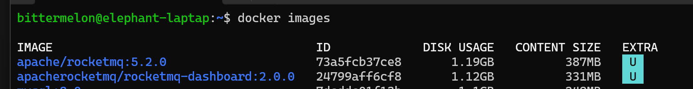
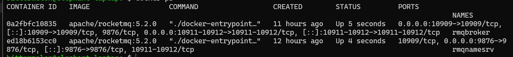
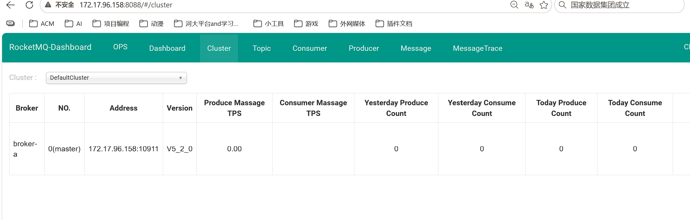
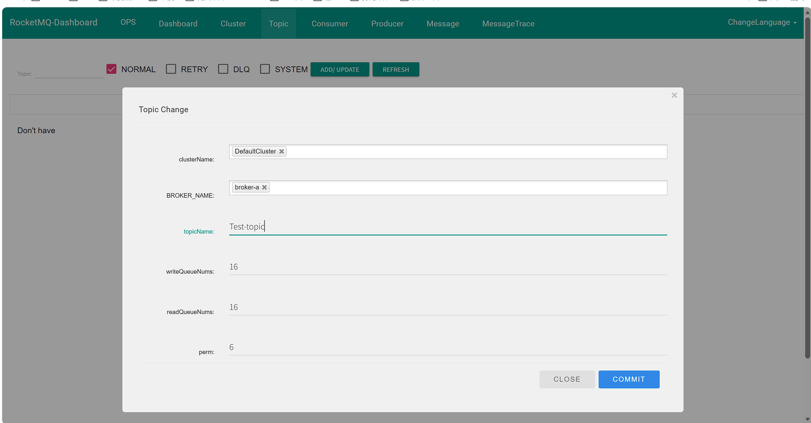
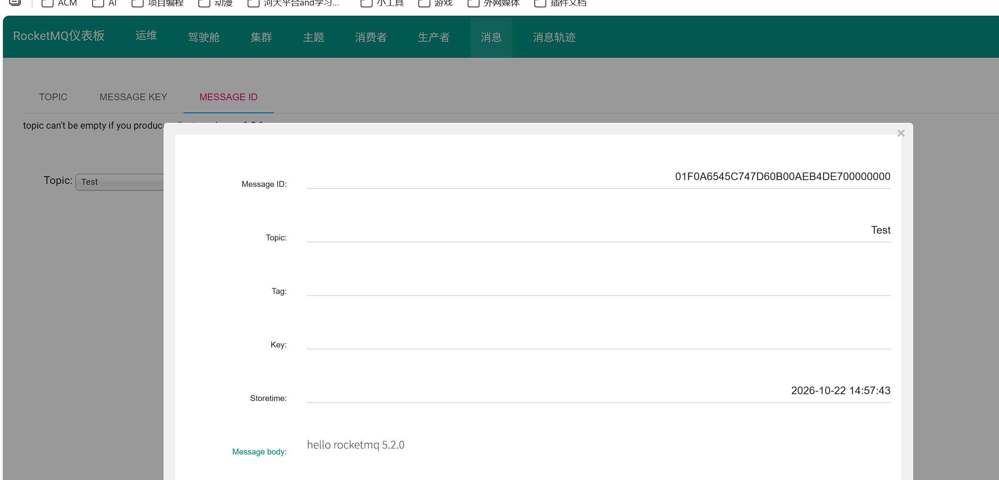

# 一、MQ基本概念
## 1.1 MQ是什么
我们可以拆开来看，M对应`Message`消息，Q对应`Queue`队列，消息就是数据比如信息，邮件；队列就是存放这些数据的容器，所以我们就可以将mq理解为是消息队列，存放消息的容器
## 1.2 MQ的作用
### 1.2.1 异步调用
异步调用就是在调用一个接口时，在接口执行业务的同时，我们可以进行下面业务的执行，不用等待该接口执行完在接着执行 

mq作为中间件，接口就会将调用的指令放入mq中，然后继续执行。
### 1.2.2 削峰填谷
MQ 像**蓄水池**：瞬时洪峰请求先存入 MQ 持久化排队；下游消费者**按自己最大能力匀速拉取消息消费**，把尖峰流量摊平，保护数据库 / 下游服务不被瞬间打垮。

- 上游：秒杀大量请求写入 MQ，主流程快速返回「排队中」，不阻塞
- 下游：消费者匀速消费，高峰过后，低峰期继续消化队列堆积消息 → **填谷**

> 
> 本质：**用时间换稳定性，不会提升系统总处理上限，只是把瞬时压力延后**

### 1.2.3 解耦合
降低了两个接口之间的耦合性，做到了低耦合，因为之间有一个mq，没有直接连接了

# 二、RocketMQ
## 2.1 基本概念
### 2.1.2 什么是RocketMQ
是阿里开源的项目，后捐献给apache，成为顶级项目
### 2.1.3 RocketMQ的基本概念
`producer`:消息的生产者，发送者 
`consumer`:消息的接收者 
`Topic`:主题，对消息进行分类的依据 
`Queue`:队列，存放消息 
`Broker`:暂存和传输消息的通道 
`NameServer`:路由中心，管理Broker，可以参考`Nacos` 
`producerGroup`:生产者组 
`consumerGroup`:消费者组 

>[!TIP]
一个`Broker`中可以有多个`Queue`,然后里面存放按照`Topic`分类的信息

### 2.1.4 `NameServer`
类似Nacos，Broker的消息被注册到这里，生产者，消费者会从这里被路由到具体的Broker中
#### 1.写的负载均衡
生产者存入某个Topic的消息，会经过NameServer路由到Broker，当有多个时，就会采取轮询的方式按照顺序进行，这样就到达了均衡的效果
#### 2.读的负载均衡
消费者在获取某个Topic的消息时，会从NameServer中根据这个`Topic`去查询在哪个Broker中然后去读取其中的消息，这个时候我们可以设置同一个topic的主从Broker这样就会做到读的负载均衡

# 三、安装
## 3.1 docker安装
### 3.1.1 docker镜像安装
~~~shell
# 拉取指定版本
docker pull apache/rocketmq:5.2.0

# 拉取最新版
docker pull apache/rocketmq:latest
~~~
拉取面板：
~~~shell
docker pull apacherocketmq/rocketmq-dashboard:latest
~~~
拉取完成后，输入`docker images`查看如图：

## 3.2 配置broker的文件
在这里broker，nameserver公用一个镜像。我们在当前目录创建一个文件broker.conf通过指令`nano broker.conf`创建文件 
配置内容如下：
~~~shell
# 集群名称，同一个集群下所有broker必须clusterName相同
brokerClusterName = DefaultCluster
# broker节点名称，主从节点名字一样（比如broker-a主、broker-a从）
brokerName = broker-a
# brokerId：0代表master主节点；大于0代表slave从节点
brokerId = 0
# 什么时候删除过期消息，04=凌晨4点执行清理
deleteWhen = 04
# 文件保留时长，单位小时，超过该时间的消息文件会被清理
fileReservedTime = 48
# ASYNC_MASTER：异步刷盘的主节点；SYNC_MASTER同步主节点；SLAVE从节点
brokerRole = ASYNC_MASTER
# ASYNC_FLUSH：异步刷盘，性能高；SYNC_FLUSH同步刷盘，可靠性高，性能差
flushDiskType = ASYNC_FLUSH
# 【重点】broker对外暴露的IP，客户端连接用，**只写IP，不带端口**
brokerIP1=172.17.96.158
# 自动创建topic，开发环境打开；生产环境关闭，禁止自动建主题
autoCreateTopicEnable=true
# broker监听端口，默认10911，客户端收发消息端口
listenPort=10911
~~~
>[!NOTE]
这里我们直接在容器内部就编辑了配置文件不用再本地创建了
### （拓展）Linux中创建文件方式
- nano broker.conf 编辑文件，没有直接创建然后进行编辑，操作简单
- touch broker.conf 只创建一个文件，不会编辑
- cat > broker.conf <<EOF 这里粘贴你的配置文本 EOF，创建后直接将你输入的内容写入文件
- vim broker.conf  跟nano一样，但是不是自带的，需要下载，而且操作不如nano简单
## 3.3 创建容器内部网络
创建一个公用的独立的内部网络才能更方便的访问
~~~shell
docker network create rocketmq
~~~
## 3.4 创建容器
先清空之前创建的容器：
~~~shell
docker rm -f rmqnamesrv rmqbroker rmqproxy rmq-dashboard
~~~

创建nameserver
~~~shell
docker run -d \
--name rmqnamesrv \
--network rocketmq \
-p 9876:9876 \
apache/rocketmq:5.2.0 \
sh mqnamesrv
~~~

创建broker
~~~shell
docker run -d \
--name rmqbroker \
--network rocketmq \
-p 10911:10911 -p 10912:10912 \
-e NAMESRV_ADDR=rmqnamesrv:9876 \
-e BROKER_IP1=172.17.96.158 \
apache/rocketmq:5.2.0 \
sh -c 'echo "brokerIP1=172.17.96.158" >> /home/rocketmq/rocketmq-5.2.0/conf/broker.conf && sh mqbroker -c /home/rocketmq/rocketmq-5.2.0/conf/broker.conf'
~~~
>[!TIP]
5.0版本之后会有一个proxy模式，这里我们分开进行创建，也可以一起创建

创建proxy
~~~shell
docker run -d \
--name rmqproxy \
--network rocketmq \
-p 10909:10909 -p 8080:8080 -p 8081:8081 \
-e NAMESRV_ADDR=rmqnamesrv:9876 \
apache/rocketmq:5.2.0 \
sh -c '
cat > /home/rocketmq/rocketmq-5.2.0/conf/rmq-proxy.json << EOF
{
  "rocketMQClusterName": "DefaultCluster",
  "nameSrvAddr": "rmqnamesrv:9876",
  "proxyMode": "local"
}
EOF
sh mqproxy
'
~~~
>[!NOTE]
5.2.0有一个bug就：Proxy 启动时要自动创建系统内部广播 Topic `DefaultHeartBeatSyncerTopic`，但是创建失败，Proxy 直接退出RocketMQ，**本质是 proxyMode 默认 cluster 模式的兼容性问题**，改成 `local` 本地模式就能绕过去。
创建dashboard
~~~shell
docker run -d \
--name rmq-dashboard \
--network rocketmq \
-p 8088:8080 \
-e NAMESRV_ADDR=rmqnamesrv:9876 \
apacherocketmq/rocketmq-dashboard:2.0.0
~~~
>[!TIP]
这里每个docker指令最后一行的意思是执行容器的启动脚本，对于broker跟nameserver由于是一个镜像所以需要利用`sh`指定内部的具体执行脚本

我们可以查看日志，看是否启动成功
~~~shell
# namesrv日志
docker logs -f rmqnamesrv

# broker日志（重点！启动失败优先看这个）
docker logs -f rmqbroker

# dashboard控制台日志
docker logs -f rmq-dashboard
~~~
如果觉得日志太多也可以加上限制：
~~~shell
# 查看broker最后200行日志
docker logs --tail 200 rmqbroker

# 看最近10分钟日志
docker logs --since 10m rmqbroker
~~~
通过docker ps我们就能看到当前正在运行的容器：

>[!TIP]
需要注意的是我们这里容器启动是由顺序的,`docker start rmqnamesrv  rmqbroker  rmqproxy rmq-dashboard`
## 3.5 访问dashboard
dashboard默认是8080端口，但是在项目中8080会被别的占用，所以我们可以在启动时修改它的端口号为8088

成功后:

# 四、Proxy介绍（5.x版本新特性）
等于是一个中间处理件，老版本是生产者发送消息后到达nameserver，再到broker，而现在是生产者发送的消息先到proxy（8081）再到nameserver，然后到broker。 

## 4.1 Proxy 核心作用：

1. **协议转换**
   - 对外：提供 gRPC（8081），标准化协议，Go/Python/C++ 等多语言 SDK 友好
   - 对内：转成 RocketMQ 原生 Remoting 协议和 Broker、NameServer 通信
2. **无状态，可独立弹性扩容**（云原生最大价值）
Broker 是有状态（存消息，扩容麻烦）；Proxy 无状态，流量暴涨的时候直接多加几个 Proxy 实例扛连接、鉴权、路由请求，**不用动存储 Broker**。
3. **统一接入层，收拢权限、限流、监控**
ACL 权限、流量限流、TLS 加密、请求埋点都放在 Proxy 这一层，Broker 专心做消息存储，职责拆分（存算分离）。
4. **兼容两种模式**

- Local 模式：Proxy 和 Broker 同进程启动（你现在 Docker 一键部署就是这种，简单，适合学习）
- Cluster 模式：Proxy 独立集群部署，生产大规模用

# 五、快速入门
## 5.1 依赖引入
由于我们使用的是5.2.0版本所以会引入对应的版本，而且与4.x版本有所不同
~~~xml
 <dependency>
            <groupId>org.apache.rocketmq</groupId>
            <artifactId>rocketmq-client-java</artifactId>
            <version>5.2.0</version>
        </dependency>
~~~
## 5.2 基本代码
### 5.2.1 生产者
~~~java
  //这里是proxy的连接，不是nameserver
        String endpoint =  "172.17.96.158:8081";
        String topic = "Test-topic";

        //创建生产者，老版是 new DefaultMQProducer
        ClientServiceProvider clientServiceProvider = ClientServiceProvider.loadService();
        //设置连接proxy的地址，老版直接就是producer.setNamesrvAddr("localhost:9876");连接nameserver
        ClientConfiguration clientConfiguration = ClientConfiguration.newBuilder().setEndpoints(endpoint).build();

        // 初始化生产者
        Producer producer = clientServiceProvider.newProducerBuilder()
                .setTopics(topic)
                .setClientConfiguration(clientConfiguration)
                .build();//这里一build后就会自动启动，不用像之前的老版本一样start（）

        // 构造消息
        Message message = clientServiceProvider.newMessageBuilder()
                .setTopic(topic)//必填项，消息一级分类
                .setBody("hello rocketmq 5.2.0".getBytes())//这里不管是新版本还是老版都是字节数组
                .build();

        //新版本返回的SendReceipt与老版本的SendResult功能一样
        SendReceipt receipt = producer.send(message);
        System.out.println("msgId:" + receipt.getMessageId());

        producer.close();
~~~
由于新版本无法在消息发送时自动创建topic，需要自己手动创建，我们可以引入`rocketmq-admin`进行创建，也可以在dashboard中创建，这里我们暂时选择后者

在idea中执行完代码会显示:
>msgId:01F0A6545C747D21EC0AEB103E00000000

对应的我们直接在dashboard上通过messageid查询:

### 5.2.2 消费者
~~~java
  String endpoint = "127.0.0.1:8081";
        String topic = "Test";

        ClientServiceProvider clientServiceProvider = ClientServiceProvider.loadService();
        ClientConfiguration clientConfiguration = ClientConfiguration.newBuilder().setEndpoints(endpoint).build();

        FilterExpression filterExpression = new FilterExpression("*", FilterExpressionType.TAG);

        PushConsumer consumer = clientServiceProvider
                .newPushConsumerBuilder()
                .setConsumerGroup("TestConsumerGroup2")
                .setClientConfiguration(clientConfiguration)
                .setSubscriptionExpressions(Collections.singletonMap(topic, filterExpression))
                .setMessageListener(messageView -> {
                    System.out.println("Received message: " + messageView.getBody().toString());
                    return ConsumeResult.SUCCESS;
                })
                .setConsumptionThreadCount(10) // ✅ 修正方法名
                .build();

        System.out.println("消费者启动，等待消息...");
        System.in.read();
        consumer.close();
~~~
在dashboard上我们就能看到我们注册的消费者组了，并且回调方法中就能接收到信息
