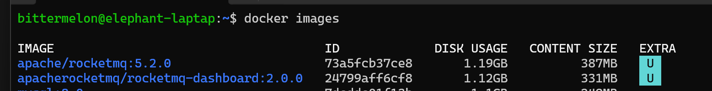
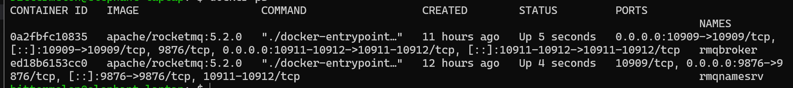
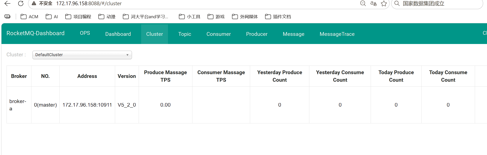
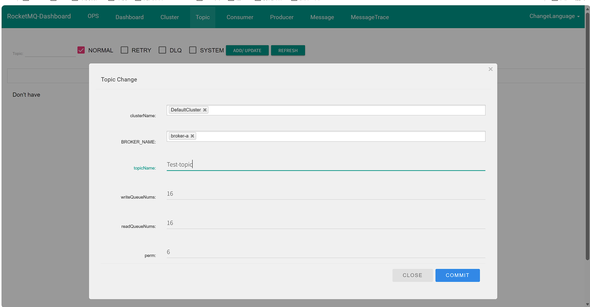
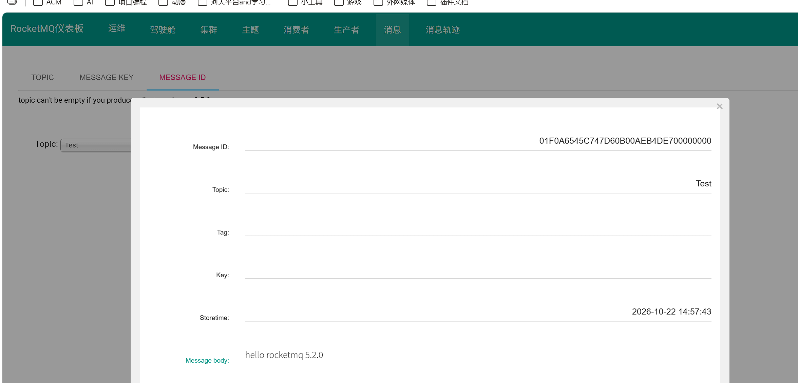
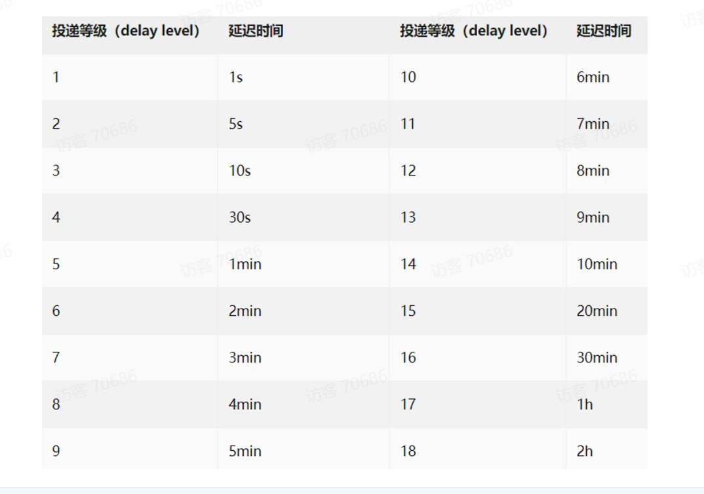

# 一、MQ基本概念

## 1.1 MQ是什么

我们可以拆开来看，M对应`Message`消息，Q对应`Queue`队列，消息就是数据比如信息，邮件；队列就是存放这些数据的容器，所以我们就可以将mq理解为是消息队列，存放消息的容器

## 1.2 MQ的作用

### 1.2.1 异步调用

异步调用就是在调用一个接口时，在接口执行业务的同时，我们可以进行下面业务的执行，不用等待该接口执行完在接着执行 

mq作为中间件，接口就会将调用的指令放入mq中，然后继续执行。

### 1.2.2 削峰填谷

MQ 像**蓄水池**：瞬时洪峰请求先存入 MQ 持久化排队；下游消费者**按自己最大能力匀速拉取消息消费**，把尖峰流量摊平，保护数据库 / 下游服务不被瞬间打垮。

- 上游：秒杀大量请求写入 MQ，主流程快速返回「排队中」，不阻塞
- 下游：消费者匀速消费，高峰过后，低峰期继续消化队列堆积消息 → **填谷**

>
> 本质：**用时间换稳定性，不会提升系统总处理上限，只是把瞬时压力延后**

### 1.2.3 解耦合

降低了两个接口之间的耦合性，做到了低耦合，因为之间有一个mq，没有直接连接了

# 二、RocketMQ

## 2.1 基本概念

### 2.1.2 什么是RocketMQ

是阿里开源的项目，后捐献给apache，成为顶级项目

### 2.1.3 RocketMQ的基本概念

`producer`:消息的生产者，发送者 
`consumer`:消息的接收者 
`Topic`:主题，对消息进行分类的依据 
`Queue`:队列，存放消息 
`Broker`:暂存和传输消息的通道 
`NameServer`:路由中心，管理Broker，可以参考`Nacos` 
`producerGroup`:生产者组 
`consumerGroup`:消费者组 

>[!TIP]
一个`Broker`中可以有多个`Queue`,然后里面存放按照`Topic`分类的信息

### 2.1.4 `NameServer`

类似Nacos，Broker的消息被注册到这里，生产者，消费者会从这里被路由到具体的Broker中

#### 1.写的负载均衡

生产者存入某个Topic的消息，会经过NameServer路由到Broker，当有多个时，就会采取轮询的方式按照顺序进行，这样就到达了均衡的效果

#### 2.读的负载均衡

消费者在获取某个Topic的消息时，会从NameServer中根据这个`Topic`去查询在哪个Broker中然后去读取其中的消息，这个时候我们可以设置同一个topic的主从Broker这样就会做到读的负载均衡

# 三、安装

## 3.1 docker安装

### 3.1.1 docker镜像安装

~~~shell
# 拉取指定版本
docker pull apache/rocketmq:5.2.0

# 拉取最新版
docker pull apache/rocketmq:latest
~~~

拉取面板：

~~~shell
docker pull apacherocketmq/rocketmq-dashboard:latest
~~~

拉取完成后，输入`docker images`查看如图：

## 3.2 配置broker的文件

在这里broker，nameserver公用一个镜像。我们在当前目录创建一个文件broker.conf通过指令`nano broker.conf`创建文件 
配置内容如下：

~~~shell
# 集群名称，同一个集群下所有broker必须clusterName相同
brokerClusterName = DefaultCluster
# broker节点名称，主从节点名字一样（比如broker-a主、broker-a从）
brokerName = broker-a
# brokerId：0代表master主节点；大于0代表slave从节点
brokerId = 0
# 什么时候删除过期消息，04=凌晨4点执行清理
deleteWhen = 04
# 文件保留时长，单位小时，超过该时间的消息文件会被清理
fileReservedTime = 48
# ASYNC_MASTER：异步刷盘的主节点；SYNC_MASTER同步主节点；SLAVE从节点
brokerRole = ASYNC_MASTER
# ASYNC_FLUSH：异步刷盘，性能高；SYNC_FLUSH同步刷盘，可靠性高，性能差
flushDiskType = ASYNC_FLUSH
# 【重点】broker对外暴露的IP，客户端连接用，**只写IP，不带端口**
brokerIP1=172.17.96.158
# 自动创建topic，开发环境打开；生产环境关闭，禁止自动建主题
autoCreateTopicEnable=true
# broker监听端口，默认10911，客户端收发消息端口
listenPort=10911
~~~

>[!NOTE]
这里我们直接在容器内部就编辑了配置文件不用再本地创建了

### （拓展）Linux中创建文件方式

- nano broker.conf 编辑文件，没有直接创建然后进行编辑，操作简单
- touch broker.conf 只创建一个文件，不会编辑
- cat > broker.conf <<EOF 这里粘贴你的配置文本 EOF，创建后直接将你输入的内容写入文件
- vim broker.conf  跟nano一样，但是不是自带的，需要下载，而且操作不如nano简单

## 3.3 创建容器内部网络

创建一个公用的独立的内部网络才能更方便的访问

~~~shell
docker network create rocketmq
~~~

## 3.4 创建容器

先清空之前创建的容器：

~~~shell
docker rm -f rmqnamesrv rmqbroker rmqproxy rmq-dashboard
~~~

创建nameserver

~~~shell
docker run -d \
--name rmqnamesrv \
--network rocketmq \
-p 9876:9876 \
apache/rocketmq:5.2.0 \
sh mqnamesrv
~~~

创建broker

~~~shell
docker run -d \
--name rmqbroker \
--network rocketmq \
-p 10911:10911 -p 10912:10912 \
-e NAMESRV_ADDR=rmqnamesrv:9876 \
-e BROKER_IP1=172.17.96.158 \
apache/rocketmq:5.2.0 \
sh -c 'echo "brokerIP1=172.17.96.158" >> /home/rocketmq/rocketmq-5.2.0/conf/broker.conf && sh mqbroker -c /home/rocketmq/rocketmq-5.2.0/conf/broker.conf'
~~~

>[!TIP]
5.0版本之后会有一个proxy模式，这里我们分开进行创建，也可以一起创建

创建proxy

~~~shell
docker run -d \
--name rmqproxy \
--network rocketmq \
-p 10909:10909 -p 8080:8080 -p 8081:8081 \
-e NAMESRV_ADDR=rmqnamesrv:9876 \
apache/rocketmq:5.2.0 \
sh -c '
cat > /home/rocketmq/rocketmq-5.2.0/conf/rmq-proxy.json << EOF
{
  "rocketMQClusterName": "DefaultCluster",
  "nameSrvAddr": "rmqnamesrv:9876",
  "proxyMode": "local"
}
EOF
sh mqproxy
'
~~~

>[!NOTE]
5.2.0有一个bug就：Proxy 启动时要自动创建系统内部广播 Topic `DefaultHeartBeatSyncerTopic`，但是创建失败，Proxy 直接退出RocketMQ，**本质是 proxyMode 默认 cluster 模式的兼容性问题**，改成 `local` 本地模式就能绕过去。
创建dashboard

~~~shell
docker run -d \
--name rmq-dashboard \
--network rocketmq \
-p 8088:8080 \
-e NAMESRV_ADDR=rmqnamesrv:9876 \
apacherocketmq/rocketmq-dashboard:2.0.0
~~~

>[!TIP]
这里每个docker指令最后一行的意思是执行容器的启动脚本，对于broker跟nameserver由于是一个镜像所以需要利用`sh`指定内部的具体执行脚本

我们可以查看日志，看是否启动成功

~~~shell
# namesrv日志
docker logs -f rmqnamesrv

# broker日志（重点！启动失败优先看这个）
docker logs -f rmqbroker

# dashboard控制台日志
docker logs -f rmq-dashboard
~~~

如果觉得日志太多也可以加上限制：

~~~shell
# 查看broker最后200行日志
docker logs --tail 200 rmqbroker

# 看最近10分钟日志
docker logs --since 10m rmqbroker
~~~

通过docker ps我们就能看到当前正在运行的容器：

>[!TIP]
需要注意的是我们这里容器启动是由顺序的,`docker start rmqnamesrv  rmqbroker  rmqproxy rmq-dashboard`

## 3.5 访问dashboard

dashboard默认是8080端口，但是在项目中8080会被别的占用，所以我们可以在启动时修改它的端口号为8088

成功后:

# 四、Proxy介绍（5.x版本新特性）

等于是一个中间处理件，老版本是生产者发送消息后到达nameserver，再到broker，而现在是生产者发送的消息先到proxy（8081）再到nameserver，然后到broker。 

## 4.1 Proxy 核心作用

1. **协议转换**
   - 对外：提供 gRPC（8081），标准化协议，Go/Python/C++ 等多语言 SDK 友好
   - 对内：转成 RocketMQ 原生 Remoting 协议和 Broker、NameServer 通信
2. **无状态，可独立弹性扩容**（云原生最大价值）
Broker 是有状态（存消息，扩容麻烦）；Proxy 无状态，流量暴涨的时候直接多加几个 Proxy 实例扛连接、鉴权、路由请求，**不用动存储 Broker**。
3. **统一接入层，收拢权限、限流、监控**
ACL 权限、流量限流、TLS 加密、请求埋点都放在 Proxy 这一层，Broker 专心做消息存储，职责拆分（存算分离）。
4. **兼容两种模式**

- Local 模式：Proxy 和 Broker 同进程启动（你现在 Docker 一键部署就是这种，简单，适合学习）
- Cluster 模式：Proxy 独立集群部署，生产大规模用

# 五、快速入门

## 5.1 依赖引入

由于我们使用的是5.2.0版本所以会引入对应的版本，而且与4.x版本有所不同

~~~xml
 <dependency>
            <groupId>org.apache.rocketmq</groupId>
            <artifactId>rocketmq-client-java</artifactId>
            <version>5.2.0</version>
        </dependency>
~~~

4.x版本

~~~xml
 <dependency>
        <groupId>org.apache.rocketmq</groupId>
        <artifactId>rocketmq-client</artifactId>
        <version>4.9.2</version>
        <!--docker的用下面这个版本-->
        <version>4.4.0</version>
    </dependency>
~~~

## 5.2 基本代码

### 5.2.1 生产者

5.x版本

~~~java
  //这里是proxy的连接，不是nameserver
        String endpoint =  "172.17.96.158:8081";
        String topic = "Test-topic";

        //创建生产者，老版是 new DefaultMQProducer
        ClientServiceProvider clientServiceProvider = ClientServiceProvider.loadService();
        //设置连接proxy的地址，老版直接就是producer.setNamesrvAddr("localhost:9876");连接nameserver
        ClientConfiguration clientConfiguration = ClientConfiguration.newBuilder().setEndpoints(endpoint).build();

        // 初始化生产者
        Producer producer = clientServiceProvider.newProducerBuilder()
                .setTopics(topic)
                .setClientConfiguration(clientConfiguration)
                .build();//这里一build后就会自动启动，不用像之前的老版本一样start（）

        // 构造消息
        Message message = clientServiceProvider.newMessageBuilder()
                .setTopic(topic)//必填项，消息一级分类
                .setBody("hello rocketmq 5.2.0".getBytes())//这里不管是新版本还是老版都是字节数组
                .build();

        //新版本返回的SendReceipt与老版本的SendResult功能一样
        SendReceipt receipt = producer.send(message);
        System.out.println("msgId:" + receipt.getMessageId());

        producer.close();
~~~

由于新版本无法在消息发送时自动创建topic，需要自己手动创建，我们可以引入`rocketmq-admin`进行创建，也可以在dashboard中创建，这里我们暂时选择后者

在idea中执行完代码会显示:
>msgId:01F0A6545C747D21EC0AEB103E00000000

对应的我们直接在dashboard上通过messageid查询:

4.x版本

~~~java
@Test
public void testProducer() throws Exception {
    // 创建默认的生产者（指定生产者组名）
    DefaultMQProducer producer = new DefaultMQProducer("test-group");
    // 设置nameServer地址
    producer.setNamesrvAddr("localhost:9876");
    // 启动实例
    producer.start();
    for (int i = 0; i < 1; i++) {
        // 创建消息
        // 第一个参数：主题的名字
        // 第二个参数：消息内容（要转化为字节数组）
        Message msg = new Message("TopicTest", ("Hello RocketMQ " + i).getBytes());
        // 发送结果
        SendResult send = producer.send(msg);
        // 打印发送状态
        System.out.println(send.getSendStatus());
    }
    // 关闭实例
    producer.shutdown();
}
~~~

### 5.2.2 消费者

5.x版本

~~~java
  String endpoint = "127.0.0.1:8081";
        String topic = "Test";

        ClientServiceProvider clientServiceProvider = ClientServiceProvider.loadService();
        ClientConfiguration clientConfiguration = ClientConfiguration.newBuilder().setEndpoints(endpoint).build();

        FilterExpression filterExpression = new FilterExpression("*", FilterExpressionType.TAG);

        PushConsumer consumer = clientServiceProvider
                .newPushConsumerBuilder()
                .setConsumerGroup("TestConsumerGroup2")
                .setClientConfiguration(clientConfiguration)
                .setSubscriptionExpressions(Collections.singletonMap(topic, filterExpression))
                .setMessageListener(messageView -> {
                    System.out.println("Received message: " + messageView.getBody().toString());
                    return ConsumeResult.SUCCESS;
                })
                .setConsumptionThreadCount(10) // ✅ 修正方法名
                .build();

        System.out.println("消费者启动，等待消息...");
        System.in.read();
        consumer.close();
~~~

在dashboard上我们就能看到我们注册的消费者组了，并且回调方法中就能接收到信息
4.x版本

~~~java
@Test
public void simpleConsumer() throws Exception {
    // 创建一个消费者
    DefaultMQPushConsumer consumer = new DefaultMQPushConsumer("test-consumer-group");
    // 连接 namesrv
    consumer.setNamesrvAddr(MqConstant.NAME_SRV_ADDR);
    // 订阅一个主题  * 表示订阅这个主题中所有的消息，后面会有消息过滤的教程
    consumer.subscribe("testTopic", "*");
    // 设置一个监听器 (一直监听的，异步回调方式，消费者线程和监听线程不是一个线程)
    consumer.registerMessageListener(new MessageListenerConcurrently() {
        @Override
        public ConsumeConcurrentlyStatus consumeMessage(List<MessageExt> msgs, ConsumeConcurrentlyContext context) {
            // 这个就是消费的方法 （业务处理）
            System.out.println("我是消费者");
            // msgs 虽然是List，但是只有一条消息，所以get(0)就行
            System.out.println(msgs.get(0).toString());
            // 消息内容从字节数组转化为String
            System.out.println("消息内容:" + new String(msgs.get(0).getBody()));
            System.out.println("消费上下文:" + context);
            // 返回值  CONSUME_SUCCESS成功，消息会从mq出队
            return ConsumeConcurrentlyStatus.CONSUME_SUCCESS;
            // RECONSUME_LATER（报错/null）失败 消息会重新回到队列 过一会重新投递出来 给当前消费者或者其他消费者消费的
//                return ConsumeConcurrentlyStatus.RECONSUME_LATER;
        }
    });
    // 启动
    consumer.start();
    // 挂起当前的jvm，让监听一直存在
    System.in.read();
}
~~~

## 5.3 特性

- 一个生产者组对应多个主题，但是一个消费者组一般只消费一个主题
- 当一个消费者组消费一个主题时，消息分为负载均衡与广播模式
- 在一个topic中我们是可以定义队列的个数的，生产者传递消息时按照次序投递到对应的队列
- 当一个消费者组有多个消费者去消费一个含有多个队列的topic是是尽可能均匀的去消费的，多出的消费者就收不到消息

# 六、发送消息方式

## 6.1 同步发送

- 调用`send`方式，在 MQ 集群中，要等到所有的从机都复制了消息以后才会返回，这样**时间就会很长**，但是**安全**
- 在4.x版本中返回的是`SendResult`,在5.x版本中就是`SendReceipt`

## 6.2 异步发送

- 异步就是不需要等待，就可以接着执行
- 4.x调用`send`5.x调用`sendMessageAsync(message, SendCallback)` 回调。
-

4.x异步调用生产者：

~~~java
@Test
public void asyncProducer() throws Exception {
    DefaultMQProducer producer = new DefaultMQProducer("async-producer-group");
    producer.setNamesrvAddr(MqConstant.NAME_SRV_ADDR);
    producer.start();
    Message message = new Message("asyncTopic", "我是一个异步消息".getBytes());
    producer.send(message, new SendCallback() {
        // 异步回调方法
        @Override
        public void onSuccess(SendResult sendResult) {
            System.out.println("发送成功");
        }

        @Override
        public void onException(Throwable e) {
            System.err.println("发送失败:" + e.getMessage());
        }
    });
    System.out.println("我先执行");
    // 挂起jvm
    System.in.read();
}

~~~

4.x异步消费者:

~~~java
@Test
public void testAsyncConsumer() throws Exception {
    // 创建默认消费者组
    DefaultMQPushConsumer consumer = new DefaultMQPushConsumer("consumer-group");
    // 设置nameServer地址
    consumer.setNamesrvAddr("localhost:9876");
    // 订阅一个主题来消费   *表示没有过滤参数 表示这个主题的任何消息
    consumer.subscribe("TopicTest", "*");
    // 注册一个消费监听 MessageListenerConcurrently是并发消费
    // 默认是20个线程一起消费，可以参看 consumer.setConsumeThreadMax()
    consumer.registerMessageListener(new MessageListenerConcurrently() {
        @Override
        public ConsumeConcurrentlyStatus consumeMessage(List<MessageExt> msgs,
                                                        ConsumeConcurrentlyContext context) {
            // 这里执行消费的代码 默认是多线程消费
            System.out.println(Thread.currentThread().getName() + "----" + msgs);
            return ConsumeConcurrentlyStatus.CONSUME_SUCCESS;
        }
    });
    consumer.start();
    System.in.read();
}
~~~

## 6.3 单向信息

- 这种方式主要用在不关心发送结果的场景（没有同步或者异步回调，不在乎消息是否发送成功），例如日志信息的发送
- 这种方式吞吐量很大，但是存在消息丢失的风险
- 5.x是`sendMessageOneWay(message)`
4.x单项生产者：

~~~java
@Test
public void testOnewayProducer() throws Exception {
    // 创建默认的生产者
    DefaultMQProducer producer = new DefaultMQProducer("test-group");
    // 设置nameServer地址
    producer.setNamesrvAddr("localhost:9876");
    // 启动实例
    producer.start();
    Message msg = new Message("TopicTest", ("单向消息").getBytes());
    // 发送单向消息
    producer.sendOneway(msg);
    // 关闭实例
    producer.shutdown();
}
~~~

## 6.4 延迟消息

- 消息放入 MQ 后，过一段时间，才会被消费者监听到
- 在4.x版本是不能自定义延迟时间，只能根据延迟等级规定的时间

~~~java
@Test
public void testDelayProducer() throws Exception {
    // 创建默认的生产者
    DefaultMQProducer producer = new DefaultMQProducer("ms-consumer-group");
    // 设置nameServer地址
    producer.setNamesrvAddr("localhost:9876");
    // 启动实例
    producer.start();
    Message msg = new Message("TopicTest", ("延迟消息").getBytes());
    // 给这个消息设定一个延迟级别，每个级别对应一个时间
    // messageDelayLevel = "1s 5s 10s 30s 1m 2m 3m 4m 5m 6m 7m 8m 9m 10m 20m 30m 1h 2h
    msg.setDelayTimeLevel(3);
    // 发送单向消息
    producer.send(msg);
    // 打印时间
    System.out.println(new Date());
    // 关闭实例
    producer.shutdown();
}
~~~

但是在5.x版本就可以自己定义了

~~~java
Message message = new Message("orderMsTopic", "订单号，座位号".getBytes());
// 直接设置延迟多少秒
message.setDelayTimeSec(500);
// 设置延迟多少毫秒
// message.setDelayTimeMs(100);
// 发延迟消息
producer.send(message);
~~~

消费者的代码跟接受普通的消息一样

## 6.5 顺序消息

### 6.5.1 原理

- 顺序消息是指消息按照一定顺序进行
- 因为topic中的队列如果有多个，事先规定好的顺序的消息可能会因为轮询到达不同的队列，从而在消费者消费时导致消息消费次序改变
- 这个时候我们需要将一定顺序的消息放入到一个队列中这样就保证了顺序一致，比如业务中一定是先创建订单再发货

### 6.5.2 全局顺序与局部顺序

全局就是只有一个队列，局部就是多个队列，有次序的消息放入一个队列中

### 6.5.3 快速入门

4.x生产者：

~~~java
  DefaultMQProducer producer = new DefaultMQProducer("orderly-producer-group");
    producer.setNamesrvAddr(MqConstant.NAME_SRV_ADDR);
    producer.start();
    // 发送顺序消息  发送时要确保有序 并且要发到同一个队列下面去
    msgModels.forEach(msgModel -> {
        String msgModelString = msgModel.toString();
        Message message = new Message("orderlyTopic", msgModelString.getBytes());
        try {
            producer.send(message, new MessageQueueSelector() {
                        @Override
                        public MessageQueue select(List<MessageQueue> mqs, Message msg, Object arg) {
                            // arg就是接收到的订单号 orderSn
                            // 在这里 选择队列
                            int hashCode = arg.toString().hashCode();
                            // 根据订单号hashCode，取模放到队列中，订单号一样，放到的队列一样
                            return mqs.get(hashCode % mqs.size());
                        }
                    },
                    // 传递订单号进去
                    msgModel.getOrderSn());

        } catch (Exception e) {
            e.printStackTrace();
        }
    });
    producer.shutdown();
    System.out.println("发送完成");
~~~

5.x版本的生产者，只要是一个生产者组就会发送消息到一个队列中：

~~~java
Message message = MessageBuilder.newBuilder()
        .setTopic("OrderTopic")
        .setBody("订单状态变更".getBytes())
        .setMessageGroup("1001") // ✅ 核心：相同group固定进同一个队列
        .build();
SendReceipt receipt = producer.sendMessage(message);

~~~

>[!TIP]
5.x 约束：Topic 类型必须是 `FIFO`，一个 FIFO 类型 topic 只能发顺序消息，不能混普通消息,`message.type=FIFO` 顺序消息

4.x消费者:

~~~java
@Test
public void orderlyConsumer() throws Exception {
    DefaultMQPushConsumer consumer = new DefaultMQPushConsumer("orderly-consumer-group");
    consumer.setNamesrvAddr(MqConstant.NAME_SRV_ADDR);
    consumer.subscribe("orderlyTopic", "*");//*表示所有该topic下的信息
    // MessageListenerConcurrently 并发模式 多线程的  重试16次
    // MessageListenerOrderly 顺序模式 单线程的 无限重试Integer.Max_Value
    consumer.registerMessageListener(new MessageListenerOrderly() {
        @Override
        public ConsumeOrderlyStatus consumeMessage(List<MessageExt> msgs, ConsumeOrderlyContext context) {
            System.out.println("线程id:" + Thread.currentThread().getId());
            System.out.println(new String(msgs.get(0).getBody()));
            return ConsumeOrderlyStatus.SUCCESS;
        }
    });
    consumer.start();
    System.in.read();
}
~~~

5.x消费者：

~~~java
public static final String ENDPOINT = "127.0.0.1:8081";
    public static final String TOPIC = "orderlyTopic";
    public static final String CONSUMER_GROUP = "orderly-consumer-group";

    @Test
    public void orderlyConsumer() throws Exception {
        ClientServiceProvider provider = ClientServiceProvider.loadService();
        ClientConfiguration cfg = ClientConfiguration.newBuilder()
                .setEndpoints(ENDPOINT)
                .build();

        // TAG过滤 * 接收全部tag
        FilterExpression filter = new FilterExpression("*", FilterExpressionType.TAG);

        PushConsumer consumer = provider.newPushConsumerBuilder()
                .setConsumerGroup(CONSUMER_GROUP)
                .setClientConfiguration(cfg)
                .setSubscriptionExpressions(Collections.singletonMap(TOPIC, filter))
                .setMessageListener((MessageView messageView) -> {
                    ByteBuffer bodyBuf = messageView.getBody();
                    byte[] bodyBytes = new byte[bodyBuf.remaining()];
                    bodyBuf.get(bodyBytes);
                    String body = new String(bodyBytes);

                    System.out.println("线程id:" + Thread.currentThread().getId());
                    System.out.println(body);

                    // 消费成功
                    return ConsumeResult.SUCCESS;
                })
                // 消费线程数：FIFO topic，同一个队列只会交给一个线程串行处理
                .setConsumptionThreadCount(10)
                .build();

        System.out.println("5.x FIFO顺序消费者启动，等待消息...");
        System.in.read();
        consumer.close();
    }
~~~

### 6.5.4 批量消息

RocketMQ可以一次性发送一组消息，这一组消息被投递到同一个队列中，会被当做一条消息进行消费
4.x生产者:

~~~java
@Test
public void testBatchProducer() throws Exception {
    // 创建默认的生产者
    DefaultMQProducer producer = new DefaultMQProducer("test-group");
    // 设置nameServer地址
    producer.setNamesrvAddr("localhost:9876");
    // 启动实例
    producer.start();
    // 消息实际上还是分开发的，接收的时候还是一条一条接收就行
    List<Message> msgs = Arrays.asList(
            new Message("TopicTest", "我是一组消息的A消息".getBytes()),
            new Message("TopicTest", "我是一组消息的B消息".getBytes()),
            new Message("TopicTest", "我是一组消息的C消息".getBytes())
    );
    SendResult send = producer.send(msgs);
    System.out.println(send);
    // 关闭实例
    producer.shutdown();
}
~~~

4.x消费者：

~~~java
@Test
public void testBatchConsumer() throws Exception {
    // 创建默认消费者组
    DefaultMQPushConsumer consumer = new DefaultMQPushConsumer("consumer-group");
    // 设置nameServer地址
    consumer.setNamesrvAddr("localhost:9876");
    // 订阅一个主题来消费   表达式，默认是*
    consumer.subscribe("TopicTest", "*");
    // 注册一个消费监听 MessageListenerConcurrently是并发消费
    // 默认是20个线程一起消费，可以参看 consumer.setConsumeThreadMax()
    consumer.registerMessageListener(new MessageListenerConcurrently() {
        @Override
        public ConsumeConcurrentlyStatus consumeMessage(List<MessageExt> msgs,
                                                        ConsumeConcurrentlyContext context) {
            // 这里执行消费的代码 默认是多线程消费
            System.out.println(Thread.currentThread().getName() + "----" + new String(msgs.get(0).getBody()));
            return ConsumeConcurrentlyStatus.CONSUME_SUCCESS;
        }
    });
    consumer.start();
    System.in.read();
}
~~~

# 七、Tag标签
